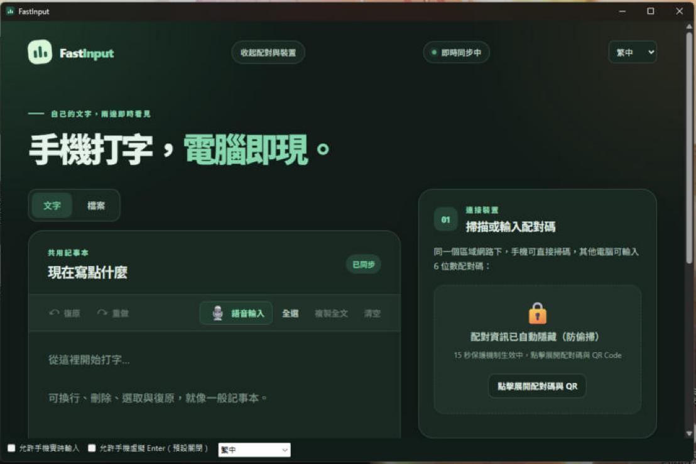
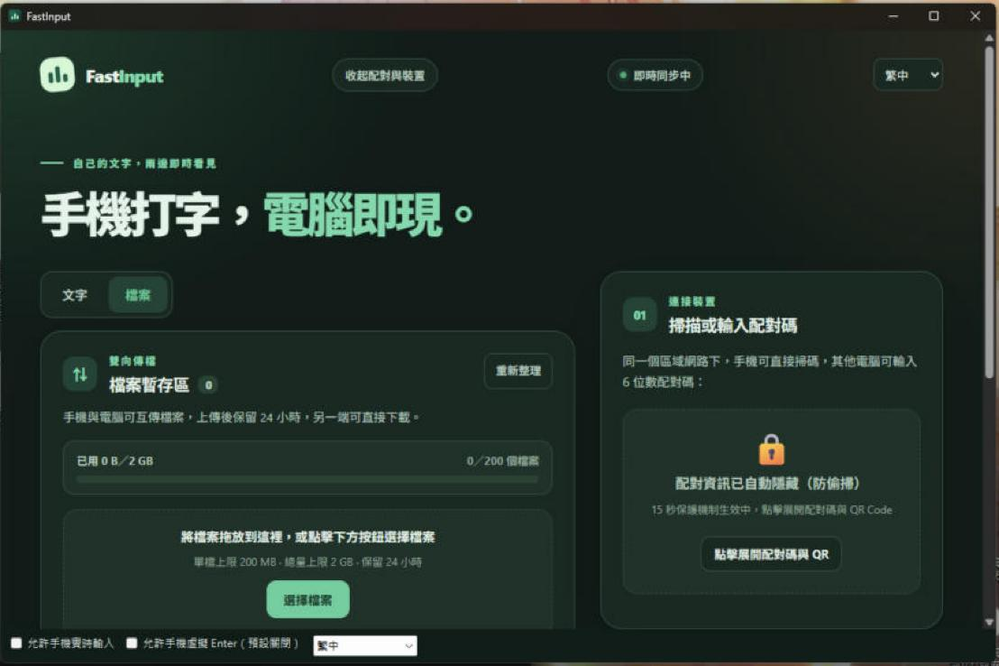

<p align="center">
  
</p>

<h1 align="center">FastInput</h1>

<p align="center">
  <a href="README.md">繁體中文</a> ·
  <a href="README.en.md">English</a> ·
  <a href="README.ja.md">日本語</a>
</p>

<p align="center">Type on your phone. Appear on your computer.</p>

FastInput lets you type in your phone's browser — including voice typing — and see the text show up on your computer. On Windows it can also type **live into whatever text field you click on the PC**. Everything runs on your local network; no cloud account is required.

> [!WARNING]
> **Beta.** Real-time typing lets your phone change the field you click on your computer, and it has only been tested in a small number of environments (see "Tested environments"). Try it with throw-away text first, and use it only on a trusted private network. Please read [Known limitations](#known-limitations) and [Data and security](#data-and-security).

## Features

- **Shared notepad** — two-way live sync between phone and PC, with undo, line breaks, and protection for IME composition (Zhuyin, Cangjie, Pinyin, …).
- **Real-time typing (Windows)** — request on the phone → approve on the PC → click a text field on the PC; whatever you type on the phone (voice typing, mid-word corrections and deletions included) appears in that field. The clipboard is not used.
  - Every session needs explicit approval on the PC; it lasts at most 5 minutes and ends after 60 seconds without new text.
  - Emergency stop hotkey (`Ctrl+Alt+F12` by default; if taken, FastInput automatically falls back to `Ctrl+Alt+Shift+F12`, `Ctrl+Alt+Pause`, …). Any physical keyboard or mouse input also revokes the session immediately.
  - Password fields, terminals, elevated windows and FastInput itself are refused automatically.
  - Optional "virtual Enter": **off by default**, can only be enabled on the PC, and needs a 600 ms long-press on the phone to send a single Enter.
  - The audit log records events and results only — **never the text you typed**.
- **File transfer** — send files between phone and PC (200 MB per file, 2 GB total, up to 200 files, kept for 24 hours).
- **Pairing** — scan a QR code, or enter a 6-digit PIN; five wrong attempts lock pairing for 60 seconds.
- **Three UI languages** — Traditional Chinese, Japanese, English; switch at any time.
- No cloud account; data travels only between your PC and phone over the LAN.

## Screenshots

> Test content only; pairing codes, QR codes and device addresses are masked.

| Shared notepad | File transfer |
| --- | --- |
|  |  |

## Install with the MSI

1. Download `FastInput-Windows-x64-<version>.msi` from [Releases](../../releases) and check the SHA-256 shown there.
2. Double-click to install (administrator rights are required). The wizard shows the GPL-3.0 license and lets you opt out of the desktop shortcut.
3. This project is developed by a student in spare time and is not signed with a paid code-signing certificate, so Windows SmartScreen may warn you. After confirming the file came from this repository, choose "More info → Run anyway".
4. Requires Windows 11 (or Windows 10 with the Microsoft Edge WebView2 Runtime). .NET is bundled.

A portable `FastInput-windows-x64.zip` is also available: extract it and run `FastInput.exe`.

## Getting started

1. Put your phone and PC on the same local network, with router "client isolation" turned off.
2. Start FastInput. Windows Firewall may ask on first run — choose **Private networks**.
3. Scan the QR code in the window with your phone (or open the address shown and enter the 6-digit PIN).
4. To type into other programs: tick **"Allow phone real-time typing"** at the bottom of the window (a risk notice and confirmation appear), open the **Real-time** tab on the phone, tap **Request**, make sure the verification codes match, approve on the PC, then click the target field with your mouse.
5. Press the emergency stop hotkey, or just touch the keyboard/mouse, to end the session at any time.

## Compatibility (real-time typing)

| Target | Status |
| --- | --- |
| Chrome `input` / `textarea` / `contenteditable` | Tested |
| Classic Win32 `EDIT` / `RichEdit` controls (incl. WinForms TextBox / RichTextBox) | Tested |
| Microsoft Edge | Same mechanism as Chrome; not tested yet |
| New Windows Notepad (RichEditD2DPT) | Not supported yet |
| WPF, Office, Electron, games | Not supported yet |
| Password fields, terminals, elevated windows | Always refused |
| macOS | Shared notepad and files work; real-time typing is not available yet |
| iPhone / Safari | Not tested |

## Known limitations

- The LAN connection uses **plain HTTP**. Pairing controls which phones may connect, but a malicious device on the same network could still observe or tamper with traffic. Use it only on a trusted private network, never forward the port to the internet, and do not send passwords through it.
- Real-time typing is not atomic between the last safety check and the key injection. If focus changes in that instant, characters may land in another window. FastInput reports and pauses afterwards, but cannot fully prevent this.
- Chrome's UI Automation reads are slow: a mid-text correction takes roughly 0.3–1 s per step, while pure appending is faster.
- Fields containing emoji can only be appended to; mid-text edits are refused.
- The very first click on a Chrome field is occasionally rejected as "unsupported"; clicking again usually works.
- Locking the screen, sleep, or the UAC secure desktop stops and revokes the session.

## Tested environments

| Software / device | Version / environment |
| --- | --- |
| Windows 11 Pro | build 26300 |
| PC browser | Google Chrome (Windows) |
| Phone | Samsung Android + Chrome |

These are the environments used during development; other versions may work too.

## Data and security

The shared text and paired-device list are stored locally on the PC:

| OS | Files |
| --- | --- |
| Windows | `%APPDATA%\FastInput\state.json`, audit log `%LOCALAPPDATA%\FastInput\audit\` |
| macOS | `~/Library/Application Support/FastInput/state.json` |

`state.json` contains your text and pairing credentials — do not share it. The audit log holds only timestamps, program short names, events, results and reason codes; it never contains what you typed.

## Build from source

Requires Rust stable, the .NET 8 SDK, and Visual Studio's "Desktop development with C++" workload.

```powershell
cargo test --locked
powershell -ExecutionPolicy Bypass -File scripts/build-windows.ps1
```

This produces `dist/FastInput-windows/FastInput.exe` and `dist/FastInput-windows-x64.zip`. To build the MSI you also need [WiX Toolset 5](https://wixtoolset.org/) (free, MS-RL):

```powershell
dotnet tool install --global wix --version 5.0.2
wix extension add -g WixToolset.UI.wixext/5.0.2
powershell -ExecutionPolicy Bypass -File packaging/windows/build-msi.ps1
```

macOS: `bash scripts/build-macos.sh` (needs Xcode and Swift; ad-hoc signed only, not notarized).

More documentation: [real-time protocol](docs/REALTIME_PROTOCOL.md), [Windows native side](docs/REALTIME_NATIVE.md), [virtual Enter spec](docs/REALTIME_ENTER_SPEC.md), [files API](docs/FILES_API.md), [i18n](docs/I18N.md), [test checklist](docs/TESTING.md).

## License and credits

FastInput is licensed under **GPL-3.0-or-later**; see [LICENSE](LICENSE). Third-party open-source components are listed in [THIRD_PARTY_LICENSES.md](THIRD_PARTY_LICENSES.md), with full license texts in [THIRD_PARTY_NOTICES.txt](THIRD_PARTY_NOTICES.txt). The legally binding full terms are in [LICENSE](LICENSE).

## Trademarks

FastInput is an independent project and is not affiliated with, sponsored by or endorsed by Google, Microsoft, Samsung or Apple.

Android and Chrome are trademarks of Google LLC; Google and related product names and logos belong to their respective owners. Microsoft, Windows, Microsoft Edge and WebView2 are trademarks of the Microsoft group of companies. Samsung and Galaxy are trademarks of Samsung Electronics Co., Ltd. Apple, iPhone, iOS, Safari, Mac and macOS are trademarks of Apple Inc. Other company and product names may be trademarks of their respective owners; they are mentioned here only to describe compatibility.

## Disclaimer

Please read this in full before use. By using, installing or distributing this software you acknowledge and accept the following.

1. **Provided "as is", without warranty.** FastInput is beta software developed by a student in spare time. It is provided "AS IS" and "AS AVAILABLE", without warranty of any kind, express or implied, including but not limited to merchantability, fitness for a particular purpose, non-infringement, uninterrupted or error-free operation, or freedom from data loss. It has **not been independently security-audited**, and there is no commitment to support or updates.
2. **Real-time typing changes the content of other programs directly.**
   - It inserts, replaces and deletes text in the field you click. **These changes may not be reversible**, and the target program's own "undo" may not restore them.
   - The final safety check and the key injection are not atomic. If focus changes at the last instant, characters may land in another window, be submitted by mistake, or interfere with another program's automation.
   - Do **not** use it for tasks that must be exact, irreversible or high-stakes — for example banking and payments, medical matters, legal documents, account and permission settings, system administration, formal exams or assessments, or live streams and presentations. Back up important content and try it with throw-away text first.
   - "Virtual Enter" can submit forms, send messages or trigger default buttons, and this cannot be taken back. It is off by default; enabling it means you accept the consequences.
   - While a session is authorized, anyone holding the paired phone can type into the field you approved. Make sure the paired device is yours, and press the emergency stop or close FastInput before leaving your seat.
3. **Network and data.** The LAN connection uses plain HTTP and cannot withstand malicious devices on the same network. Do not use it to send passwords, keys, personal data or other secrets, and do not use it on public Wi-Fi or untrusted networks; the author is not responsible for data exposed through your phone, router or network. Shared text, pairing credentials and transferred files are stored temporarily on your own computer — keeping and deleting them is your responsibility.
4. **Comply with rules and obtain authorization.** You must make sure your use complies with local law and with the rules of your school, employer, exam venue, game or other platform (some games, anti-cheat systems, security products and enterprise management tools may treat simulated input as a violation or as suspicious). Use it only on computers and accounts you own or are explicitly authorized to use, and **never to operate someone else's computer without their consent**.
5. **No compatibility guarantee.** Testing was limited to the environments listed in this README. Updates to Windows, Chrome, Edge WebView2, Android and various input methods may break or change behavior, and antivirus or administration software may block or flag it.
6. **Limitation of liability.** To the maximum extent permitted by law, the author and contributors are not liable for any direct, indirect, incidental, special or consequential damages arising from use of or inability to use this software (including data loss or corruption, messages sent in error, mis-operation, lost business, damage to devices or accounts, or disclosure of confidential information), even if advised of the possibility. This statement supplements and does not replace sections 15–17 of GPL-3.0-or-later (disclaimer of warranty and limitation of liability); where they conflict, the one more protective of the author that the law permits applies.
7. **Unofficial, unaffiliated.** FastInput is not affiliated with, sponsored by or endorsed by Microsoft, Google, Samsung, Apple or any other company. Windows, Chrome, Edge, WebView2, Android, Samsung, Safari and similar names and trademarks belong to their respective owners and are used only to describe compatibility.
8. **Unsigned.** Release files are not signed with a paid code-signing certificate. Download only from this repository's Releases and verify the SHA-256; the author cannot vouch for copies obtained elsewhere.

If you do not agree with any of the above, do not use this software.
