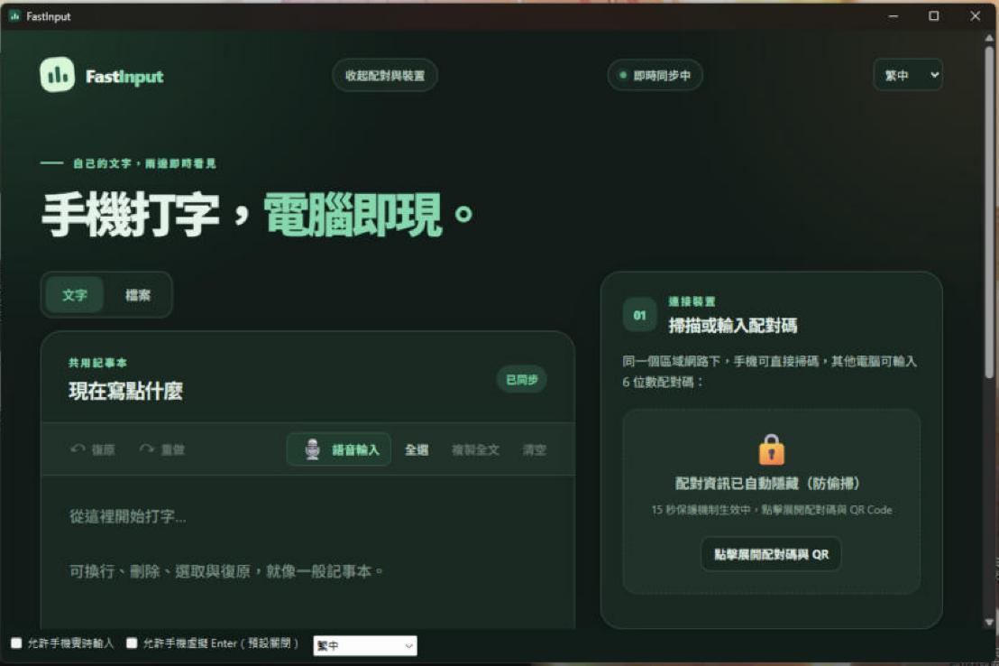
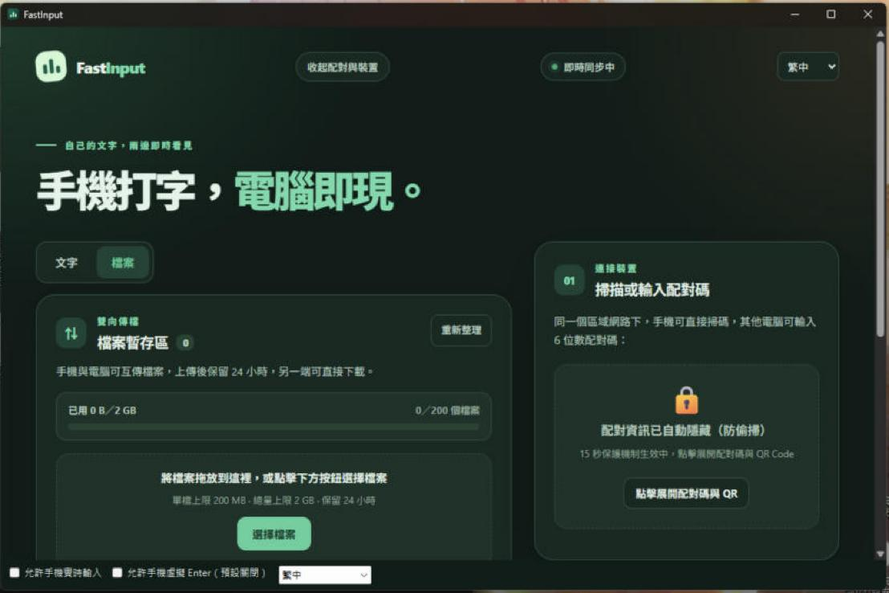

<p align="center">
  
</p>

<h1 align="center">FastInput</h1>

<p align="center">
  <a href="README.md">繁體中文</a> ·
  <a href="README.en.md">English</a> ·
  <a href="README.ja.md">日本語</a>
</p>

<p align="center">スマホで入力、パソコンに即反映。</p>

FastInput は、スマートフォンのブラウザで入力した文字（音声入力を含む）をパソコンへ届けるアプリです。Windows では、**パソコン側でクリックした入力欄にそのまま文字を入力**することもできます。通信はローカルネットワーク内だけで完結し、クラウドアカウントは不要です。

> [!WARNING]
> **ベータ版です。** リアルタイム入力は、スマホからパソコン上の入力欄を書き換える機能で、ごく限られた環境でしか検証していません（「検証環境」を参照）。まずはテスト用の文字で試し、信頼できるプライベートネットワークでのみ使ってください。ご利用前に[既知の制限](#既知の制限)と[データとセキュリティ](#データとセキュリティ)をお読みください。

## 機能

- **共有メモ帳** — スマホとパソコンで双方向にリアルタイム同期。元に戻す、改行、IME（注音・倉頡・拼音など）の変換中保護に対応。
- **リアルタイム入力（Windows）** — スマホで要求 → パソコンで承認 → パソコン上の入力欄をクリック。以後スマホで入力した文字（音声入力、途中の訂正・削除を含む）がその欄にそのまま入ります。クリップボードは使いません。
  - 毎回パソコン側での明示的な承認が必要です。許可は最長 5 分、新しい文字が 60 秒なければ自動終了します。
  - 緊急停止キー（既定は `Ctrl+Alt+F12`。使用済みの場合は `Ctrl+Alt+Shift+F12`、`Ctrl+Alt+Pause` などへ自動で切り替え）。物理キーボード／マウスの操作でも直ちに許可を取り消します。
  - パスワード欄、ターミナル、管理者権限のウィンドウ、FastInput 自身は自動的に拒否します。
  - 任意の「仮想 Enter」は**既定でオフ**。パソコン側でのみ有効化でき、スマホで 600 ミリ秒長押しすると Enter を 1 回だけ送ります。
  - 監査ログには出来事と結果だけを記録し、**入力した文字は記録しません**。
- **ファイル転送** — スマホとパソコン間でファイルを送受信（1 ファイル 200 MB、合計 2 GB、最大 200 個、24 時間保存）。
- **ペアリング** — QR コードのスキャン、または 6 桁の PIN。5 回連続で間違えると 60 秒ロックされます。
- **3 つの表示言語** — 繁体字中国語・日本語・英語をいつでも切り替えできます。
- クラウドアカウント不要。データは LAN 内でパソコンとスマホの間だけを流れます。

## スクリーンショット

> テスト用の内容です。ペアリングコード、QR コード、端末のアドレスは隠してあります。

| 共有メモ帳 | ファイル転送 |
| --- | --- |
|  |  |

## MSI でインストール

1. [Releases](../../releases) から `FastInput-Windows-x64-<バージョン>.msi` をダウンロードし、同じページの SHA-256 と照合します。
2. ダブルクリックでインストールします（管理者権限が必要）。ウィザードに GPL-3.0 のライセンスが表示され、デスクトップショートカットの作成は選択できます。
3. 本プロジェクトは学生が余暇に個人開発しており、有償のコード署名証明書を使っていないため、Windows SmartScreen の警告が出ることがあります。入手元が本リポジトリであることを確認し、「詳細情報 → 実行」を選んでください。
4. Windows 11（または Microsoft Edge WebView2 Runtime を導入した Windows 10）が必要です。.NET は同梱されています。

インストール不要の `FastInput-windows-x64.zip` もあります。展開して `FastInput.exe` を実行してください。

## はじめかた

1. スマホとパソコンを同じローカルネットワークに接続し、ルーターの「クライアント分離」をオフにします。
2. FastInput を起動します。初回は Windows ファイアウォールの確認が出ることがあるので、**プライベート ネットワーク**を選びます。
3. ウィンドウ内の QR コードをスマホで読み取ります（または表示されたアドレスを開いて 6 桁の PIN を入力）。
4. 他のアプリに直接入力するには、ウィンドウ下部の「**スマホからのリアルタイム入力を許可**」にチェック（リスクの説明と確認が出ます）。スマホで「リアルタイム」タブを開いて「要求」をタップし、両方の確認コードが一致していることを見てからパソコンで承認し、入力したい欄をマウスでクリックします。
5. 緊急停止キーを押すか、キーボード／マウスに触れるだけで、いつでも終了できます。

## 互換性（リアルタイム入力）

| 対象 | 状態 |
| --- | --- |
| Chrome の `input`／`textarea`／`contenteditable` | 検証済み |
| 従来の Win32 `EDIT`／`RichEdit`（WinForms の TextBox／RichTextBox を含む） | 検証済み |
| Microsoft Edge | Chrome と同じ方式。未検証 |
| 新しい Windows メモ帳（RichEditD2DPT） | 未対応 |
| WPF、Office、Electron、ゲーム | 未対応 |
| パスワード欄、ターミナル、管理者権限のウィンドウ | 常に拒否 |
| macOS | 共有メモ帳とファイルは利用可。リアルタイム入力は未提供 |
| iPhone／Safari | 未検証 |

## 既知の制限

- LAN 内の通信は **HTTP（平文）** です。ペアリングは接続できるスマホを限定しますが、同じネットワーク上の悪意ある機器に通信を盗み見・改ざんされる可能性があります。信頼できるプライベートネットワークでのみ使い、ポートをインターネットへ転送せず、パスワードの送信には使わないでください。
- リアルタイム入力は、最後の安全確認からキー送出までの間がアトミックではありません。その瞬間にフォーカスが切り替わると、別のウィンドウに入力される可能性があります。FastInput は事後に検知して一時停止しますが、完全には防げません。
- Chrome の UI Automation の読み取りは遅く、途中の訂正は 1 ステップあたり約 0.3〜1 秒かかります。末尾への追記のみなら高速です。
- 絵文字を含む欄は末尾への追記のみ対応で、途中の編集は拒否されます。
- Chrome の欄を最初にクリックしたとき、まれに「未対応」と判定されることがあります。もう一度クリックすれば通常は動作します。
- 画面ロック、スリープ、UAC のセキュアデスクトップ中は停止し、許可を取り消します。

## 検証環境

| ソフトウェア／端末 | バージョン／環境 |
| --- | --- |
| Windows 11 Pro | build 26300 |
| パソコン側ブラウザ | Google Chrome（Windows） |
| スマホ | Samsung Android ＋ Chrome |

開発中に実際に試した環境です。他のバージョンで動かないという意味ではありません。

## データとセキュリティ

共有テキストとペアリング済み端末の一覧は、パソコンのローカルに保存されます。

| OS | ファイル |
| --- | --- |
| Windows | `%APPDATA%\FastInput\state.json`、監査ログ `%LOCALAPPDATA%\FastInput\audit\` |
| macOS | `~/Library/Application Support/FastInput/state.json` |

`state.json` には文字とペアリング用の認証情報が含まれるため、公開しないでください。監査ログには日時、アプリの略称、出来事、結果、理由コードだけを記録し、入力した文字は含みません。

## ソースからビルド

Rust stable、.NET 8 SDK、Visual Studio の「C++ によるデスクトップ開発」ワークロードが必要です。

```powershell
cargo test --locked
powershell -ExecutionPolicy Bypass -File scripts/build-windows.ps1
```

`dist/FastInput-windows/FastInput.exe` と `dist/FastInput-windows-x64.zip` ができます。MSI をビルドするには、さらに [WiX Toolset 5](https://wixtoolset.org/)（無料、MS-RL）が必要です。

```powershell
dotnet tool install --global wix --version 5.0.2
wix extension add -g WixToolset.UI.wixext/5.0.2
powershell -ExecutionPolicy Bypass -File packaging/windows/build-msi.ps1
```

macOS: `bash scripts/build-macos.sh`（Xcode と Swift が必要。アドホック署名のみで、Apple の公証は受けていません）。

詳しいドキュメント: [リアルタイム入力プロトコル](docs/REALTIME_PROTOCOL.md)、[Windows ネイティブ側](docs/REALTIME_NATIVE.md)、[仮想 Enter 仕様](docs/REALTIME_ENTER_SPEC.md)、[ファイル API](docs/FILES_API.md)、[多言語対応](docs/I18N.md)、[テストチェックリスト](docs/TESTING.md)。

## ライセンスと謝辞

FastInput は **GPL-3.0-or-later** で提供されます。全文は [LICENSE](LICENSE) をご覧ください。利用しているサードパーティのオープンソースは [THIRD_PARTY_LICENSES.md](THIRD_PARTY_LICENSES.md) に、ライセンス全文は [THIRD_PARTY_NOTICES.txt](THIRD_PARTY_NOTICES.txt) にあります。法的効力を持つ完全な英語の条項は [LICENSE](LICENSE) をご覧ください。

## 商標

FastInput は独立して開発されているプロジェクトであり、Google、Microsoft、Samsung、Apple との提携、後援、推奨の関係はありません。

Android と Chrome は Google LLC の商標です。Google および関連する製品名・ロゴの権利は各権利者に帰属します。Microsoft、Windows、Microsoft Edge、WebView2 は Microsoft グループ企業の商標です。Samsung と Galaxy は Samsung Electronics Co., Ltd. の商標です。Apple、iPhone、iOS、Safari、Mac、macOS は Apple Inc. の商標です。その他の企業名・製品名は各権利者の商標である場合があり、本文書では互換性を説明する目的でのみ言及しています。

## 免責事項

ご利用の前に必ず最後までお読みください。本ソフトウェアを使用・インストール・配布することで、以下の内容を理解し、同意したものとみなします。

1. **「現状のまま」提供し、保証はありません。** FastInput は学生が余暇に開発しているベータ版ソフトウェアです。「現状有姿（AS IS）」かつ「提供可能な範囲（AS AVAILABLE）」で提供され、商品性、特定目的への適合性、非侵害、中断やエラーがないこと、データが失われないことを含め、明示・黙示を問わず一切の保証をしません。第三者によるセキュリティ監査は**受けておらず**、サポートや更新の約束もありません。
2. **リアルタイム入力は、他のアプリの内容を直接書き換えます。**
   - クリックした入力欄に文字を挿入・置換・削除します。**これらの変更は元に戻せない場合があり**、対象アプリの「元に戻す」で復元できるとは限りません。
   - 最後の安全確認とキー送出の間はアトミックではありません。直前にフォーカスが切り替わると、別のウィンドウへ文字が入ったり、誤って送信されたり、他のアプリの自動処理と干渉したりすることがあります。
   - 正確さが必須のもの、取り消せないもの、影響の大きいものには**使わないでください**。例：金融・決済、医療、法的文書、アカウントや権限の設定、システム管理、正式な試験・評価、配信やプレゼンの本番。重要な内容は事前にバックアップし、まずテスト用の文字で確認してください。
   - 「仮想 Enter」はフォームの送信、メッセージの送信、既定ボタンの実行につながる可能性があり、取り消せません。既定でオフです。オンにした場合の結果は自己責任となります。
   - 許可中は、ペアリング済みのスマホを持つ人なら誰でも、承認した入力欄に文字を入力できます。ペアリングしたのが自分の端末であることを確認し、席を離れる前に緊急停止を押すか FastInput を閉じてください。
3. **ネットワークとデータ。** LAN 内の通信は HTTP（平文）で、同じネットワーク上の悪意ある機器には対抗できません。パスワード、鍵、個人情報、その他の機密の送信には使わず、公衆 Wi-Fi や信頼できないネットワークでも使わないでください。スマホ、ルーター、ネットワーク環境を通じて情報が漏れても、作者は責任を負いません。共有テキスト、ペアリング用の認証情報、転送したファイルはお使いのパソコン内に一時保存されます。その保管と削除は利用者の責任です。
4. **規則の遵守と権限の確認。** お住まいの地域の法令、および学校・勤務先・試験会場・ゲームやその他のプラットフォームの規則に沿った使い方であることを、利用者自身で確認してください（ゲーム、アンチチート、セキュリティ製品、企業の管理ツールの中には、擬似的な入力を違反や不審な動作と見なすものがあります）。ご自身が所有、または明示的に許可を得たパソコンとアカウントにのみ使用し、**他人のパソコンを本人の同意なく操作する目的では使わないでください**。
5. **互換性の保証はありません。** 検証範囲は本 README に記載した環境に限られます。Windows、Chrome、Edge WebView2、Android、各種入力方式のアップデートにより、機能が使えなくなったり動作が変わったりすることがあります。ウイルス対策や管理ソフトに遮断・誤検知される場合もあります。
6. **責任の制限。** 法律で認められる最大限の範囲で、作者および貢献者は、本ソフトウェアの使用または使用不能から生じる直接的、間接的、付随的、特別または派生的な損害（データの消失・破損、誤送信、誤操作、事業上の損失、機器やアカウントの損害、機密情報の漏えいを含む）について、あらかじめ可能性を知らされていたとしても責任を負いません。本項は GPL-3.0-or-later の第 15 条〜第 17 条（無保証・責任の制限）を補足するもので、置き換えるものではありません。両者が矛盾する場合は、法律上認められる範囲で作者をより保護する方が優先されます。
7. **非公式・無関係。** FastInput は Microsoft、Google、Samsung、Apple その他いかなる企業とも提携、後援、推奨の関係にありません。Windows、Chrome、Edge、WebView2、Android、Samsung、Safari などの名称・商標は各権利者に帰属し、互換性の説明のためだけに使用しています。
8. **署名なし。** 配布ファイルは有償のコード署名証明書で署名されていません。必ず本リポジトリの Releases から入手し、SHA-256 を確認してください。他の場所で入手したものの内容について、作者は保証できません。

上記のいずれかに同意できない場合は、本ソフトウェアを使用しないでください。
