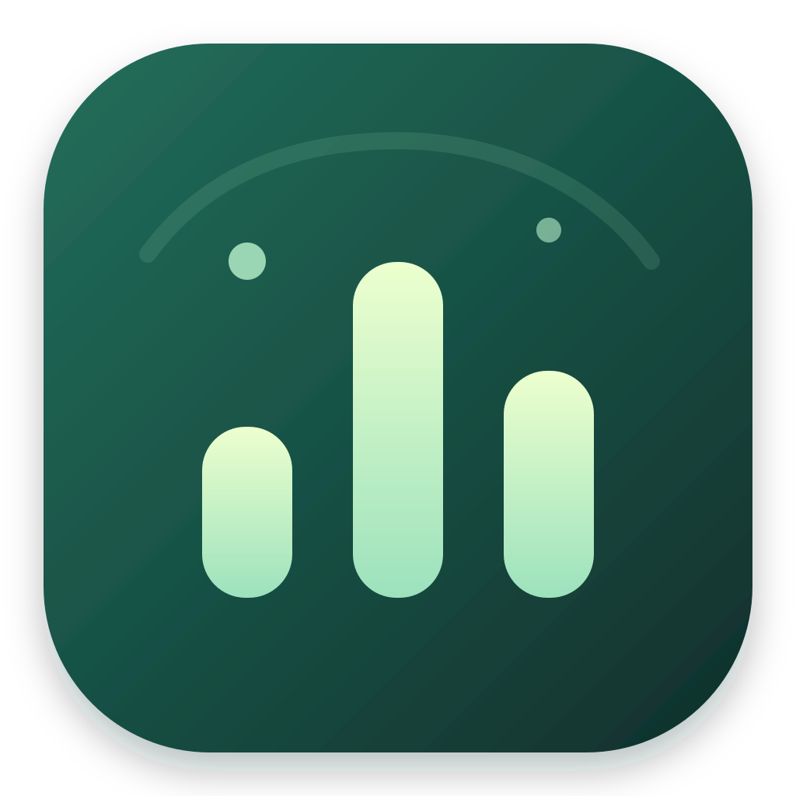
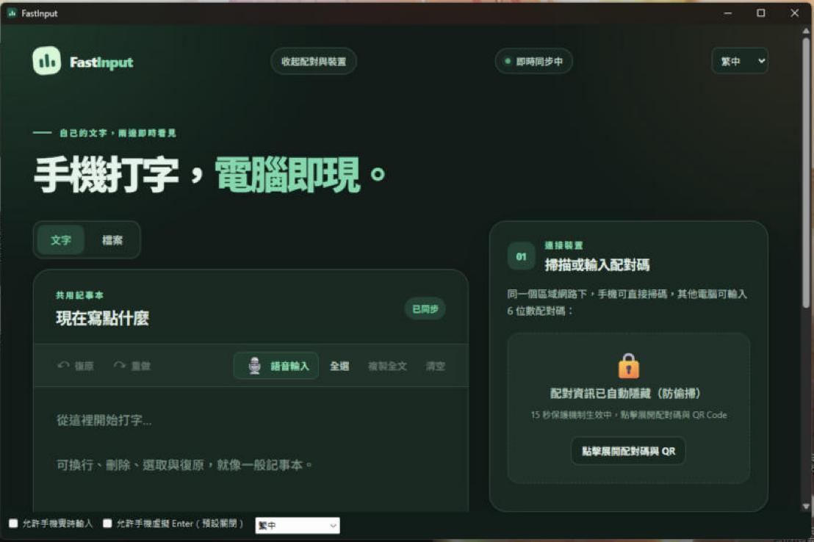
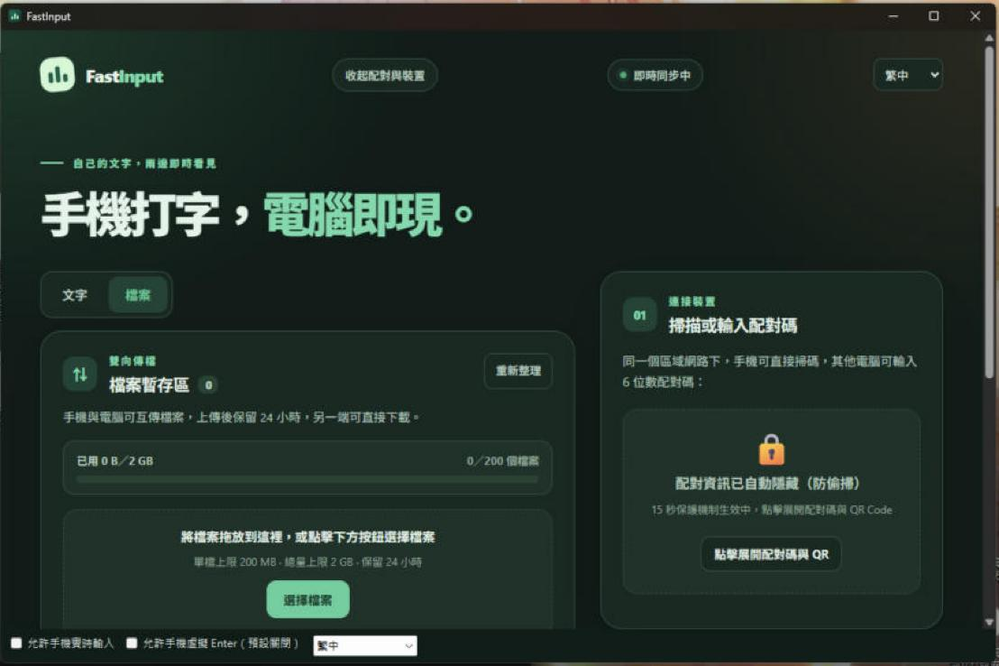

<p align="center">
  
</p>

<h1 align="center">FastInput</h1>

<p align="center">
  <a href="README.md">繁體中文</a> ·
  <a href="README.en.md">English</a> ·
  <a href="README.ja.md">日本語</a>
</p>

<p align="center">手機打字，電腦即現。</p>

**English:** FastInput lets you type on your phone's browser and see the text appear on your computer — and, on Windows, appear live inside whatever text field you click on the PC. Everything stays on your local network; no cloud account is needed.
<br>
**日本語:** FastInput は、スマートフォンのブラウザで入力した文字をパソコンへ即座に届けるアプリです。Windows では、パソコン側でクリックした入力欄にそのまま文字が入ります。通信はローカルネットワーク内だけで完結し、クラウドアカウントは不要です。

> 用手機（包含語音輸入）打字，文字就出現在電腦裡；<br>
> 不用雲端、不用帳號，只要同一個區域網路。

> [!WARNING]
> **目前為 Beta 版本。** 「實時輸入模式」會讓手機改動電腦上你點選的欄位，只在少數環境實測過（見「實測環境」）。請先用測試文字驗證，並只在可信的私人網路使用。使用前請閱讀[已知限制](#已知限制)與[資料與安全](#資料與安全)。

## 功能

- **共用記事本**：手機與電腦即時雙向同步，支援復原、換行與中文注音／倉頡／拼音組字保護。
- **實時輸入模式（Windows）**：手機請求 → 電腦核准 → 你點選電腦上的輸入欄位，之後手機打的字（含語音輸入、中間改字、刪除）會即時出現在該欄位，不經過剪貼簿。
  - 每次都需要電腦端明確核准；授權最長 5 分鐘、60 秒沒有新文字自動結束。
  - 緊急停止鍵（預設 `Ctrl+Alt+F12`，被占用時自動改用 `Ctrl+Alt+Shift+F12`、`Ctrl+Alt+Pause` 等）；實體鍵盤／滑鼠操作也會立即收回授權。
  - 自動拒絕密碼欄位、終端機、系統管理員權限視窗與 FastInput 自己。
  - 可選的「虛擬 Enter」，**預設關閉**，只能在電腦端打開；手機端需長按 600 毫秒才會送出一次。
  - 稽核紀錄只記錄事件與結果，**不記錄你輸入的文字**。
- **檔案傳輸**：手機與電腦互傳檔案（單檔 200 MB、總量 2 GB、最多 200 個、保留 24 小時）。
- **配對**：手機掃描 QR Code，或輸入 6 位數 PIN；連續輸錯 5 次鎖定 60 秒。
- **三種介面語言**：繁體中文、日本語、English，可隨時切換。
- 不需要雲端帳號；資料只在你的電腦與手機之間經區域網路傳輸。

## 實際畫面

> 以下畫面為測試用內容，已遮蔽配對碼、QR Code 與裝置位址。

| 共用記事本 | 檔案傳輸 |
| --- | --- |
|  |  |

## 使用 MSI 安裝

1. 前往 [Releases](../../releases) 下載 `FastInput-Windows-x64-<版本>.msi`，並核對同頁的 SHA-256。
2. 雙擊安裝（需要系統管理員權限）。安裝精靈會顯示 GPL-3.0 授權，可選擇是否建立桌面捷徑。
3. 本專案由學生利用課餘時間獨立開發，尚未使用付費的程式碼簽署憑證，Windows SmartScreen 可能顯示「Windows 已保護您的電腦」，請確認來源為本儲存庫後選「其他資訊 → 仍要執行」。
4. 需要 Windows 11（或 Windows 10 並已安裝 Microsoft Edge WebView2 Runtime）。程式已內含 .NET，無需另外安裝。

也可以下載免安裝的 `FastInput-windows-x64.zip`，解壓後執行 `FastInput.exe`。

## 開始使用

1. 確認手機與電腦在同一個區域網路，且路由器沒有開啟「用戶端隔離」。
2. 開啟 FastInput。第一次執行時 Windows 防火牆可能詢問，請選擇「私人網路」。
3. 手機掃描視窗中的 QR Code（或在手機瀏覽器輸入視窗顯示的網址與 6 位數 PIN）。
4. 想直接打進其他程式：在視窗下方勾選「**允許手機實時輸入**」（會顯示風險說明並要求確認），然後在手機頁面切到「實時」分頁、按「請求」，核對兩邊的核對碼一致後在電腦端按核准，再用滑鼠點選要輸入的欄位。
5. 隨時按緊急停止鍵，或直接操作鍵盤／滑鼠，就會結束。

## 相容性（實時輸入）

| 目標 | 狀態 |
| --- | --- |
| Chrome 的 `input`／`textarea`／`contenteditable` | 已實測 |
| 傳統 Win32 `EDIT`／`RichEdit` 控制項（含 WinForms 的 TextBox／RichTextBox） | 已實測 |
| Microsoft Edge | 採用與 Chrome 相同的方式，尚未實測 |
| 新版 Windows 記事本（RichEditD2DPT） | 暫不支援 |
| WPF、Office、Electron、遊戲 | 暫不支援 |
| 密碼欄位、終端機、系統管理員權限視窗 | 一律拒絕 |
| macOS | 共用記事本與檔案可用；實時輸入尚未提供 |
| iPhone／Safari | 尚未實測 |

## 已知限制

- 區域網路使用 **HTTP 明文**連線。配對能限制哪些手機可使用，但同一網路上的惡意裝置仍可能窺探或竄改傳輸內容。請只在信任的私人網路使用，不要轉發連接埠到網際網路，也不要用它傳送密碼。
- 實時輸入在「最後一次檢查」與「送出按鍵」之間不是原子操作；若焦點剛好在這一瞬間被切換，字可能打到別的視窗。FastInput 會在事後回報並暫停，但無法保證完全避免。
- Chrome 的 UIA 讀取較慢，在中間改字時每一步約需 0.3～1 秒；純尾端追加較快。
- 含 emoji 的欄位若要在中間修改會被拒絕，只支援尾端追加。
- 第一次點選 Chrome 欄位偶爾會被判為「不支援」，再點一次通常即可。
- 鎖定螢幕、睡眠或 UAC 安全桌面期間會停止並撤銷授權。

## 實測環境

| 軟體或裝置 | 測試版本／環境 |
| --- | --- |
| Windows 11 Pro | build 26300 |
| 電腦端瀏覽器 | Google Chrome（Windows） |
| 手機 | Samsung Android＋Chrome |

以上為開發期間實際測試的環境，不代表其他版本一定無法使用。

## 資料與安全

共用文字與已配對裝置清單保存在電腦本機：

| 系統 | 資料檔案 |
| --- | --- |
| Windows | `%APPDATA%\FastInput\state.json`、稽核紀錄 `%LOCALAPPDATA%\FastInput\audit\` |
| macOS | `~/Library/Application Support/FastInput/state.json` |

`state.json` 含文字與配對憑證，請勿公開分享。稽核紀錄只含時間、程式簡稱、事件、結果與原因代碼，不含你輸入的文字。

## 從原始碼建置

需要 Rust stable、.NET 8 SDK 與 Visual Studio 的「使用 C++ 的桌面開發」工作負載。

```powershell
cargo test --locked
powershell -ExecutionPolicy Bypass -File scripts/build-windows.ps1
```

產出 `dist/FastInput-windows/FastInput.exe` 與 `dist/FastInput-windows-x64.zip`。要建置 MSI，另需 [WiX Toolset 5](https://wixtoolset.org/)（免費，MS-RL）：

```powershell
dotnet tool install --global wix --version 5.0.2
wix extension add -g WixToolset.UI.wixext/5.0.2
powershell -ExecutionPolicy Bypass -File packaging/windows/build-msi.ps1
```

macOS：`bash scripts/build-macos.sh`（需 Xcode 與 Swift；僅臨時簽署，未經 Apple 公證）。

更多技術文件：[實時輸入協定](docs/REALTIME_PROTOCOL.md)、[Windows 原生端](docs/REALTIME_NATIVE.md)、[虛擬 Enter 規格](docs/REALTIME_ENTER_SPEC.md)、[檔案 API](docs/FILES_API.md)、[多語系](docs/I18N.md)、[測試清單](docs/TESTING.md)。

## 開源授權與致謝

FastInput 以 **GPL-3.0-or-later** 授權，全文見 [LICENSE](LICENSE)。使用的第三方開源專案與授權列於 [THIRD_PARTY_LICENSES.md](THIRD_PARTY_LICENSES.md)，完整授權文字見 [THIRD_PARTY_NOTICES.txt](THIRD_PARTY_NOTICES.txt)。具有法律效力的完整英文條款請參閱 [LICENSE](LICENSE)。

## 商標

FastInput 是獨立開發的專案，與 Google、Microsoft、Samsung 或 Apple 沒有隸屬、贊助或背書關係。

Android、Chrome 是 Google LLC 的商標；Google 及相關產品名稱與標誌，權利歸其各自權利人所有。Microsoft、Windows、Microsoft Edge 與 WebView2 是 Microsoft 集團公司的商標。Samsung 與 Galaxy 是 Samsung Electronics Co., Ltd. 的商標。Apple、iPhone、iOS、Safari、Mac 與 macOS 是 Apple Inc. 的商標。其他公司及產品名稱可能是其各自權利人的商標；本文件僅為說明相容性而提及。

## 免責聲明

請在使用前完整閱讀。使用、安裝或散布本軟體，即表示你已理解並接受以下內容。

1. **依「現況」提供，不附保證。** FastInput 是由學生利用課餘時間開發的 Beta 軟體，依「現況」（AS IS）與「現有可用狀態」（AS AVAILABLE）提供，不附任何明示或默示的保證，包括但不限於適銷性、特定用途適用性、不侵權、不中斷、無錯誤或不遺失資料。本專案**未經第三方安全稽核**，也沒有提供技術支援或更新的承諾。
2. **實時輸入會直接改動其他程式的內容。**
   - 它會在你點選的欄位中新增、取代與刪除文字，**這些改動可能無法復原**，也不一定能用該程式的「復原」還原。
   - 檢查與送出按鍵之間不是原子操作；焦點若在最後一刻被切換，字可能進入別的視窗、被誤送出，或與其他程式的自動動作互相干擾。
   - 請**不要**在需要精確、不可逆或高風險的情境使用，例如金融與付款、醫療、法律文件、帳號與權限設定、系統管理、正式考試與評量、直播或簡報當下。重要內容請先備份，並先用測試文字驗證。
   - 「虛擬 Enter」可能提交表單、傳送訊息或觸發預設按鈕，送出後無法收回。它預設關閉；開啟即代表你自行承擔其後果。
   - 授權期間，任何持有已配對手機的人都能在你核准的欄位輸入文字。請確認配對的是你自己的裝置，離開座位前先按緊急停止或關閉 FastInput。
3. **網路與資料。** 區域網路連線使用 HTTP 明文，無法抵擋同一網路上的惡意裝置。請勿用於傳送密碼、金鑰、個資或其他機密內容，也不要在公共 Wi-Fi 或不信任的網路使用；若手機、路由器或網路環境因此洩漏資料，作者不負責任。共用文字、配對憑證與傳輸的檔案會暫存在你的電腦本機，保管與刪除由你負責。
4. **遵守規範與取得授權。** 你須自行確認使用方式符合所在地法律，以及學校、公司、考場、遊戲或其他平台的規定（部分遊戲、反作弊系統、資安軟體與企業管理工具可能把模擬輸入視為違規或可疑行為）。只可用於你自己擁有或已獲明確授權的電腦與帳號，**不得用於未經同意操作他人的電腦**。
5. **相容性沒有保證。** 實測範圍僅限 README 所列環境。Windows、Chrome、Edge WebView2、Android 與各家輸入法的更新，可能使部分功能失效或行為改變；防毒或系統管理軟體也可能阻擋或誤報。
6. **責任限制。** 在法律允許的最大範圍內，作者與貢獻者對因使用或無法使用本軟體所產生的任何直接、間接、附帶、特殊或衍生損害（包括資料遺失或損毀、誤送訊息、誤操作、營業損失、裝置或帳號受損、機密外洩）概不負責，即使事先已被告知可能發生。這項聲明補充而不取代 GPL-3.0-or-later 第 15 至 17 條（無擔保與責任限制）；兩者有衝突時，以對作者較有保障且法律允許者為準。
7. **非官方、無關聯。** FastInput 與 Microsoft、Google、Samsung、Apple 或任何其他公司沒有隸屬、贊助或背書關係。Windows、Chrome、Edge、WebView2、Android、Samsung、Safari 等名稱與商標屬於各自權利人，僅用於說明相容性。
8. **未簽章。** 發行檔未使用付費的程式碼簽署憑證。請只從本儲存庫的 Releases 下載，並核對 SHA-256；從其他來源取得的版本，作者無法保證其內容。

若不同意以上任何一項，請不要使用本軟體。
