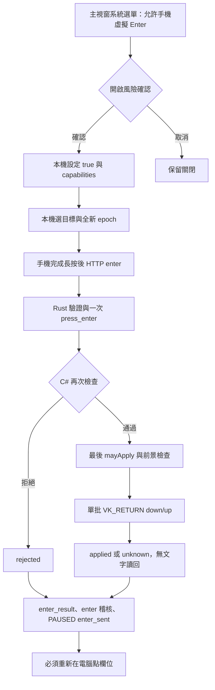

# FastInput M2b／M4 原生實時輸入

本版將 M2a 記憶體外殼接上 Windows 真實元件；保留 FakeAdapter、FakeTargetPicker 與可注入傳輸供離線測試。**本輪只編譯、跑純邏輯及 loopback HTTP/stdio 測試，沒有開外殼、fixture、Chrome、安裝全域 hook 或送 SendInput。真實桌面行為全部尚未驗證。**

## 元件與信任邊界

`RealtimeRuntime` 使用 `RealTargetPicker`、`WindowsSafetyProbe`、`TargetAdapterRouter`（Win32EditAdapter／ChromiumUiaAdapter）、`LocalPhysicalInputMonitor`。設定仍預設 `realtime_enabled=false`。`--no-realtime` 的舊 Computer 文字網址模式與 `--smoke-test` 的無實時 UI／無熱鍵行為保留。

Rust 只能提供文字意圖；`TargetCandidate` 的 HWND、頂層 HWND、程序名稱、PID、啟動時間、螢幕座標、欄位矩形、工作區、轉接層種類與 UIA runtime identity 都由本機點選產生。協定未新增 Windows 操作、測試核准 HTTP 入口或座標欄位。LiveSim 自動核准只編譯於 tools/LiveSim，正式外殼沒有該入口。

`BackendHost` 擁有 Rust `--native-stdio` 子程序，stdout 為 4-byte little-endian length + UTF-8 JSON（1–65,536 bytes），stderr 排空丟棄。未知欄位／格式／type、EOF、通道失敗永久失效。單一 writer 64 槽，滿載即撤權。hello 的私有 desktop_url 只留記憶體導航，不進稽核。

## 本機目標點選

`RealTargetPicker.Start()` 才安裝 WH_MOUSE_LL，`Stop()` 立即 UnhookWindowsHookEx，世代遞增使排隊中的舊事件失效。專用 STA message-loop thread 持有 hook delegate；背景 worker 等待約 60 ms 後查詢點擊命中的視窗與實際焦點，不在 callback 做 UIA／程序查詢／網路／等待。

只接受實體左鍵 down：拒絕 LLMHF_INJECTED／LOWER_IL_INJECTED，以及自家 dwExtraInfo marker。FastInput 自己（含主視窗、核准視窗、overlay）及子程序點擊忽略。取 WindowFromPoint、GetAncestor(GA_ROOT)、GetGUIThreadInfo 焦點，要求點擊頂層仍為前景。Win32 要命中實際焦點 EDIT；Chrome 要 UIA FromPoint 元素或其祖先與 FocusedElement 相符，且焦點元素 PID 屬於本次瀏覽器程序。

分類只接受 EDIT、WindowsForms10.EDIT.*、RichEdit／WindowsForms10.RichEdit*，或 Chrome_WidgetWin_1 且程序名為 chrome/msedge。RichEditD2DPT（含 WinForms 包裝名稱）明確不支援；Office/WPF/Electron/其他控制項不降級成盲打。失敗以固定本機原因顯示，不將 HWND、標題、欄位值或 UIA 例外文字送回 Rust。

## 授權與檢查順序

M2a 狀態仍為 REQUESTED → ARMED → BINDING → ACTIVE；30 秒核准期限、5 分鐘絕對租約、60 秒文字閒置、1500 ms 單筆期限，`elapsed >= limit` 失效。Rust 負責手機 3 秒 heartbeat，透過 revoke 通知原生。confirm_empty 後再次讀回起點才 active。

每筆套用依序檢查：

1. 本機設定、緊急熱鍵可用、授權、租約、request/epoch、停止旗標、操作世代、有效文字與序號。
2. HWND 有效、PID、程序啟動時間、同 session、前景頂層 HWND 與實際焦點 HWND。
3. 一般 Default input desktop、主程序非 elevated、目標完整性不高於主程序、非自身或子程序、黑名單、密碼／唯讀／停用。
4. 全文與最後確認的 P＋S＋Q、UTF-16 selection 完全一致。
5. 計算單一連續最小替換；副作用前再次 mayApply、安全與焦點檢查。
6. 操作後讀回全文與 selection，再查授權與目標；全部一致才回 applied + verified_readback。

`WindowsSafetyProbe` 以 OpenInputDesktop + GetUserObjectInformation 證明 Default 桌面；查詢拒絕或非 Default 皆拒絕，沒有進入安全桌面或提權。WTS 鎖定／休眠通知沿用既有外殼。token elevation／integrity、Toolhelp 祖先、程序 session、GetWindowLong 樣式與 IsWindowEnabled 查詢失敗均拒絕。所有 #32770 對話框保守拒絕，範圍比僅「執行」更廣。

終端機黑名單含 WindowsTerminal/conhost/cmd/powershell/pwsh/wt/OpenConsole/bash/wsl/mintty；亦拒絕 consent、LogonUI、winlogon、FastInput 等。傳統 EDIT 查 ES_PASSWORD (0x20)、ES_READONLY (0x800)。Chrome 的密碼、可編輯狀態與 UIA identity 由 adapter worker 每次讀回再查；controller 的 Tick 不呼叫 UIA，以免持有授權鎖等待 UIA provider。

本機詳細拒絕原因與 wire reason 分開；wire 沿用協定白名單 unsupported/focus_changed 等。查詢例外不直接顯示外部錯誤訊息。稽核只存既有固定欄位與 win32/chromium/fake 轉接層名稱；session 為 request_id 雜湊，credential 仍為 null（request frame 沒有這兩個精確 ID）。

## A：Win32EditAdapter

使用 WM_GETTEXTLENGTH／WM_GETTEXT 與 EM_GETSEL 讀回，EM_SETSEL 絕對 UTF-16 [start,end) 後 EM_REPLACESEL，只操作指定 HWND。沿用 ProbeLab 的系統訊息路徑，不使用指標型 WM_USER RichEdit 訊息跨程序。所有訊息 SendMessageTimeoutW + SMTO_ABORTIFHUNG，每則 100 ms。

EM_GETSEL 使用無指標的 packed return；為避免 16-bit selection 截斷，**全文超過 65,534 UTF-16 單位拒絕**。讀取前後長度必須相同。RichEdit 既有全文含 CR/LF 時保守拒絕：其 WM_GETTEXT 換行正規化與 EM_GETSEL 偏移映射尚未驗證；傳統 EDIT 多行不加此限制，手機本來就拒絕換行。這個上限針對外部既有全文，手機 S 仍最多 4,096 單位。

adapter 自己保存最後確認的讀回；套用前再次比對。SETSEL 後再讀全文與 selection，副作用前又查 mayApply、程序、焦點與安全；REPLACESEL 後設手機要求的 selection，再完整讀回核對。實作不靠方向鍵、Backspace 粒度、WM_SETTEXT、剪貼簿或整欄 SetValue。

任何 SendMessageTimeout 失敗均採 unknown，即使尚未送文字。SETSEL 已送後的失效或讀回不符也是 unknown。F2：逾時不是取消，Windows 訊息可能稍後生效；不重送、不回滾、不補打。選取與替換之間仍可能被目標程式或本機使用者改變，這不是交易。

`IWin32EditApi` 與 guard 可注入，單元測試用記憶體傳輸，包含「替換已生效後才逾時」案例。

## B：ChromiumUiaAdapter

使用本機真實點擊建立的瀏覽器焦點，不模擬第二次點擊。綁定與讀回要求相同 HWND/PID/啟動時間、UIA runtime ID、HasKeyboardFocus、非 IsPassword、IsEnabled。要求 TextPattern 可讀全文、可取得唯一 selection、IsReadOnlyAttribute 明確為 false；如也有 ValuePattern，Value 必須與 TextPattern 全文完全相同，否則拒絕（不自行修剪換行／正規化）。缺 TextPattern 的 Value-only 元素不能安全定位，拒絕。

BMP 範圍沿用 ProbeLab UiaProbe.SelectRange：DocumentRange.Clone → 收合至開頭 → Move(TextUnit.Character,start) → MoveEndpointByUnit(End,length) → Select。移動數與實際讀回 UTF-16 選取位置都要相符。替換以一次 SendInput 送 Unicode keydown/up，所有事件 dwExtraInfo=0x46494E50。純刪除已選取範圍用無修飾 VK_DELETE；不使用 Enter/Tab/快捷鍵、方向鍵或修飾鍵。若 Shift/Ctrl/Alt/Win 實體仍按住，拒絕送入。

選取後又讀全文、selection 與敏感狀態，輸入前最後再驗 UIA 焦點、低成本前景／程序檢查及 mayApply，然後單次送入批次。SendInput 回傳短數量為 partial／unknown，不補送。輸入批次在最後檢查前建立，實際 SendInput 前再查 mayApply、修飾鍵與 native 前景。輸入後立即讀回，容許最多 120 ms 的唯讀輪詢等待目標處理輸入佇列（不重送輸入）；焦點失效或 provider 例外在已注入後回 partial，文字／selection 不符回 unknown。唯讀輪詢仍逐次檢查授權與焦點，沒有為等待頁面而重試輸入。

**F6 競態仍存在**：最後檢查與 SendInput 之間，或單次批次交付期間，前景可被改變；可能寫到別的視窗。此實作縮小時間窗與事後偵測，不能宣稱原子安全、不能保證 OS 阻擋錯目標字元。

起點只接受收合游標，controller 保存 P/Q 不傳外部；P/Q 含 surrogate 拒絕。S 涉及 emoji 中間修改拒絕，只允許尾端追加。既有全文含非 BMP 時，只在最後確認的收合游標追加，不再以 UIA 字元單位重新定位；要求最後游標是追加後結尾。初次尾端追加 emoji 可使用其前方已驗證 BMP 範圍。**UIA emoji 字元單位映射、實際 Chrome/Edge 尾端游標讀回仍不確定，未桌面驗證。** 其他含 surrogate 的 selection 變動保守 unknown。

`IChromiumUiaApi` 可注入；純測試驗最後檢查失敗零輸入、檢查後焦點切換 partial、短 SendInput 不重試、emoji 尾端不重定位。

## 實體輸入與 hook 生命週期

`LocalPhysicalInputMonitor` 在候選完成本機點選、開始綁定前啟動 WH_KEYBOARD_LL + WH_MOUSE_LL，另安裝 EVENT_SYSTEM_FOREGROUND WinEvent hook，保留短暫切換後又切回的撤權訊號。離開綁定／ACTIVE 後停止，runtime dispose 全部解除。選目標的原始 down 已在 monitor 安裝前發生，up 不觸發接手；後續鍵盤 down/up、其他滑鼠按鈕 down/wheel、前景變更都暫停／撤權。單純 mouse move 不暫停。

只有「有注入旗標且是正式 marker」的事件被忽略；無注入旗標或其他 marker 的注入事件均視為接手。callback 只讀 metadata、寫原子 pending flag／時間戳、TryWrite 有界 64 槽 channel、CallNextHookEx，不記鍵值、不等 worker、不做 UIA。pending flag 在 worker 處理前已使 runtime safety fail closed。隊列溢位或 worker 失敗也撤權。worker 呼叫 NotifyPhysicalInput，沿用 M2a revoke(physical_input)。

hook delegate 被持有至 message loop 結束。Stop 立即解除低階 hooks 並使 picker 舊世代失效，WinEvent 在安裝執行緒收到 WM_QUIT 後解除。背景 UIA 即使卡住不會阻塞 hook callback；但 Windows 可能因系統排程或 callback 超時靜默移除低階 hook，沒有可不注入輸入就證明存活的通用心跳。F8 的 1 秒實驗是 M0 既有觀察，本輪未重新量測，不能當成所有系統的保證。

M2a 協定沒有獨立 native pause 訊息，無 apply 在途時接手／焦點改變仍透過 revoke，重新開始需重新 request/核准；沒有變更協定。有對應 apply 的 rejected 依合約 PAUSED；partial/unknown 不允許自動重綁。

## UI、設定與停止

主視窗本機系統選單控制設定，WebView 無設定入口。Ctrl+Alt+F12 RegisterHotKey（MOD_NOREPEAT）失敗包括 1409 就拒絕啟用；停止先撤權、清操作世代與佇列，不等 pipe/HTTP。UI 與熱鍵沿用 M2a。

Overlay 保留 WS_EX_NOACTIVATE | TOPMOST | TOOLWINDOW、MA_NOACTIVATE、Selectable=false 按鈕。使用 picker 的欄位矩形、Screen.GetWorkingArea 點選所在螢幕與既有 PerMonitorV2 manifest。依序嘗試下、上、右、左，必須完整位於工作區且不覆蓋欄位。**欄位佔滿工作區或工作區不足以容納 overlay 時隱藏 overlay，保留全域緊急鍵**；這是幾何上沒有合法外側位置的明確處置，該情況沒有可點的 overlay 暫停鈕。多螢幕/DPI 實際行為不確定。

設定與稽核路徑、原子保存與輪替沿用 M2a；預設 `%LOCALAPPDATA%\FastInput\realtime-settings.json` 與 `audit\realtime.jsonl`，仍支援既有 FASTINPUT_REALTIME_SETTINGS_PATH / FASTINPUT_REALTIME_AUDIT_PATH。沒有保存目標全文、token、URL 或標題。

## 可執行驗證

```powershell
$env:PATH = 'C:\Program Files\dotnet;' + $env:PATH
$env:RUSTUP_TOOLCHAIN = 'stable-x86_64-pc-windows-msvc'
cargo build --offline --target-dir .\target-p10
dotnet restore tests\RealtimeTests --source "$env:USERPROFILE\.nuget\packages"
dotnet build native\windows\FastInput.Windows.csproj --no-restore
dotnet run --project tests\RealtimeTests --no-restore
dotnet restore tools\LiveSim --source "$env:USERPROFILE\.nuget\packages"
dotnet build tools\LiveSim --no-restore
```

RealtimeTests 不開視窗或安裝 hook；新增分類、標記、guard、最小替換、unknown/partial、錯讀回與不重試等純測試。真 Rust 100-state E2E 仍使用 FakeAdapter，數字不能代表桌面延遲。測試預設後端路徑為本工作區 target-p10，支援 FASTINPUT_TEST_SERVER。

真實桌面由使用者另行執行，完整說明見 [LiveSim README](../tools/LiveSim/README.md)：

```powershell
dotnet run --project tools\LiveSim --no-build -- all
dotnet run --project tools\LiveSim --no-build -- fixture --case middle
dotnet run --project tools\LiveSim --no-build -- fixture --case incremental
dotnet run --project tools\LiveSim --no-build -- fixture --case long1000
dotnet run --project tools\LiveSim --no-build -- fixture --case reconnect
dotnet run --project tools\LiveSim --no-build -- fixture --case disconnect
dotnet run --project tools\LiveSim --no-build -- fixture --case foreground
dotnet run --project tools\LiveSim --no-build -- chrome --case input
dotnet run --project tools\LiveSim --no-build -- chrome --case textarea
```

工具用獨立測試宿主（真 controller/safety/adapters/Rust）及兄弟 fixture 程序；Chrome 全新隔離 profile，CDP 僅 loopback 讀回。加 --physical-clicks 可改用正式 picker，由使用者親手點選；預設自動點擊採 test-only picker：SendInput 必帶 injected，不可能被正式 picker 視作實體點擊；這是明確測試替代，正式外殼沒有接受 injected 的例外。報告有 JSON/Markdown、樣本數、未量測 null；閃爍為事件層觀察、錯目標只觀察自有 decoy/password。不要據此宣稱已監看整桌面。

## M4：本機授權的單一 Enter

共同規格為 [REALTIME_ENTER_SPEC.md](REALTIME_ENTER_SPEC.md)，wire 欄位／HTTP 檢查順序見 [REALTIME_PROTOCOL.md §7](REALTIME_PROTOCOL.md#7-m4單一虛擬-enter)。本輪沒有修改手機網頁。



### 設定與生命週期

`RealtimeSettings.VirtualEnterEnabled`（JSON `virtual_enter_enabled`）預設 false。唯一正式使用者入口在主視窗系統選單「允許手機虛擬 Enter（預設關閉）」。開啟時明確顯示「這會讓手機能按下電腦上的 Enter」，提示提交表單／傳送訊息／預設按鈕可能無法復原，Yes/No 預設 No。關閉先在 controller 鎖內失效本機能力、送 capabilities，再保存；保存失敗也不恢復現場能力。開啟先保存成功，再由 controller 宣告 capabilities；保存失敗還原設定。關閉不等待 HTTP 或 pipe 完成。沒有 WebView、手機或 HTTP 設定入口。

hello 後送一次 capabilities，之後每次本機設定變更再送。target_bound 的 binding／active 都帶本機程序簡稱 app_label 與 enter_allowed；程序名不合協定白名單時使用固定 other。視窗標題、URL、完整路徑、HWND 與座標不送往手機。

Enter 與文字共用操作世代、取消旗標與原有目標授權；每個 enter_id 記錄意圖與結果。同 id 完全相同只回既有結果，處理中不新增工作；同 id 不同內容回 sequence_conflict。收到 Enter 時不接受之後的文字套用。完成、拒絕或不確定都清 target／epoch、失效操作世代、轉 PAUSED enter_sent；只允許重新實體點選產生新 epoch，不使用前一段 P/S/Q 推測續接。一般 session 撤銷、斷線、緊急停止仍優先撤權。

### C# 最終檢查順序

1. 此刻讀取本機 VirtualEnterEnabled；關閉回 rejected / enter_disabled，零新增注入。
2. 核對本機授權、5 分鐘絕對／60 秒閒置租約、實時總設定、熱鍵可用、request／epoch、ACTIVE、停止旗標、操作世代與本次 Enter 在途身分。
3. 目標仍是本機選定目標：有效 HWND、相同 PID／啟動時間／session、正常 Default 桌面、前景與實際焦點相符；黑名單、完整性、密碼／唯讀／停用與 adapter 支援均重查。終端機、高權限、密碼及不支援轉接層回 enter_blocked_target，零注入。
4. after_seq 等於本機最後 applied 序號，文字 pending 計數為零且沒有文字在途，否則 text_pending；實體輸入 pending 使安全檢查拒絕。
5. 正式 `TargetAdapterRouter` 透過 `IVirtualEnterAdapter` 執行獨立 Enter 操作；`VirtualEnterSender` 及 Windows API 實作再次確認 token／mayApply、安全與前景。Chromium 以本機已保存的 UIA identity／焦點、IsPassword／IsEnabled／IsReadOnly 驗證，沒有套用後文字讀回。
6. 構造固定兩筆 INPUT，最後再驗 mayApply、無 Shift/Ctrl/Alt/Win 與 native 前景／焦點，單次 SendInput：VK_RETURN down + up，兩筆 dwExtraInfo 均為 M2b 標記 `0x46494E50`。沒有通用 key-code 介面、修飾鍵、重試、讀回或欄位變更判斷。
7. 回傳數量恰好 2 才可回 applied；短數量、例外、1500 ms 期限或是否送出的不確定性均 unknown，絕不補送。只記 enter 稽核事件、匿名 session、合格程序簡稱、結果／白名單 reason；文字與內容尾段不入稽核。

本機關閉在最後授權 callback 前使請求 rejected；callback 已通過後可能已進入 OS，保守視為 unknown。已交付的 OS 輸入無法撤銷。停止旗標與前景檢查縮小競態視窗，不能提供 SendInput 與焦點切換的原子性保證。Rust 自身 1500 ms 期限／能力關閉也可先把 Enter 記 unknown；晚到結果不會復權或重送。

### 純測試、桌面驗證與禁止事項

RealtimeTests 以假傳輸／假目標／假時鐘／假 Enter API 驗證預設關閉、黑名單、after_seq／pending、重複 id、完成後零後續輸入、逾時、關閉設定競態、稽核無文字與固定標記的單次批次；不呼叫真實 SendInput、SetForegroundWindow 或 hook。loopback HTTP／stdio E2E 仍使用 FakeAdapter。

LiveSim 只寫與編譯；使用者可自行執行（會開桌面 fixture，請先閱讀 README）：

```powershell
$env:PATH = 'C:\Program Files\dotnet;' + $env:PATH
$env:RUSTUP_TOOLCHAIN = 'stable-x86_64-pc-windows-msvc'
cargo build --offline --target-dir .\target-p10
dotnet build tools\LiveSim --no-restore
dotnet run --project tools\LiveSim --no-build -- enter
# 改由使用者親手選欄位：
dotnet run --project tools\LiveSim --no-build -- enter --physical-clicks
```

三個情境使用單行 TextBox 與表單預設按鈕，分別觀察關閉零 Enter、開啟恰好一個 Enter／預設按鈕事件、Enter 後 PAUSED 且後續文字零操作、密碼黑名單 fixture 零 Enter。黑名單情境在綁定前被拒絕，不能證明綁定後動態變敏感／提權的競態。測試宿主的 enter-on/off 只走本機 stdin，略過正式確認視窗；正式程式沒有這個測試入口。

以下均未實測，Windows 行為仍不確定：

- 實際 Enter down/up 與預設按鈕只觸發一次、SendInput 短送、焦點於最後檢查後切換、OS 排程延遲與完整性阻擋。
- 主視窗風險確認、持久化設定、關閉設定與真實注入交錯；Ctrl/Alt/Shift/Win 實體按住時的拒絕。
- 終端機、高權限、UAC／鎖定／安全桌面、密碼／唯讀／停用／目標死亡與 UIA identity 動態改變。
- 原有注入標記被 hook 忽略、實體輸入搶先暫停、hook 失效、逾時後 OS 工作晚到。
- 真手機 600 ms 長按、放開取消、內容尾段及目標提示、鍵盤 Enter／換行不得觸發，以及手機完成後文字鎖定。web 在本輪範圍外。

禁止任何 Enter 以外的新按鍵、連按／自動重複、由 SSE／heartbeat／status 觸發 Enter、文字換行、自動恢復、提權或 uiAccess。既有 M2b 文字 adapter 的 Unicode／選取刪除路徑維持原用途，不向 Enter 協定暴露通用輸入能力。

## 未驗證項與風險

- 所有真實 Windows 訊息、RichEdit 正規化／跨程序 marshalling、Chrome/Edge UIA、contenteditable、網址列、密碼／唯讀／停用動態變更尚未桌面執行。Value/TextPattern 不同、IsReadOnlyAttribute 不支援或 selection 範圍不符會保守拒絕；實際支援率不確定。
- UIA provider 可能慢或永久卡住。1500 ms controller deadline 使 epoch UNKNOWN、停止新操作，但不能強制終止已進入 COM/UIA 的 worker，也不能撤銷已交付 Windows 操作。停止授權不等 UIA；native token/程序查詢仍在 controller 鎖內，真實停止 p95 未量測。
- 本機點擊後 60 ms 的焦點成立延遲只是工程等待，不是焦點完成保證；之後仍驗證命中及焦點。過快連續操作可能拒絕，沒有保證每次點擊都成功。
- hook 安裝失敗、溢位採拒絕；靜默被 OS 移除的偵測有限。1 秒 callback 存活、休眠／鎖定／UAC／不同 session、高完整性、熱鍵衝突仍需人工驗證，未做提權或安全桌面互動。
- overlay 無空間隱藏是相對「總是顯示小介面」的明確限制；外側位置、多螢幕負座標與混合 DPI 僅純幾何測試。
- 未做實際手機與三星/iPhone 事件驗證。M4 擴充 Rust 與正式協定；web 由另一方處理，本輪未變更 web、方案書、Enter 規格或 ProbeLab。


