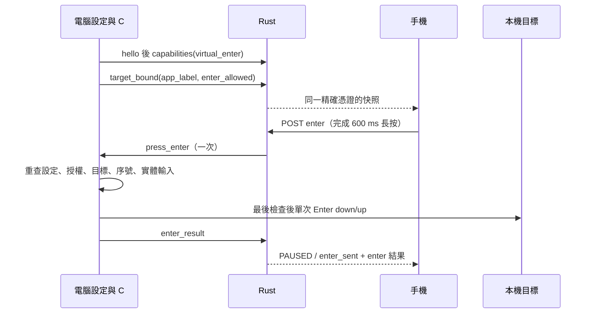

# FastInput 實時輸入協定 v1（M1／M4）

本文件是 M2 原生外殼與 M3 手機網頁的共同介面依據。M1 只提供 Rust 記憶體狀態、HTTP／SSE 與私有 stdio；不連接外部輸入框。授權、目標檢查、實際套用與讀回核對，最終由原生端負責。

## 1. 邊界與識別

- 實時文字與共用記事本的 `text/revision/generation`、檔案資料及持久化狀態完全分開；重啟不恢復實時授權。
- 一個後端同時只保留一個實時工作階段與一個 writer。授權 owner 是「精確配對 token 的 SHA-256」，不是裝置 ID、IP 或桌面 Cookie；同一裝置的兩份有效 token 不能共用 capability。
- `server_boot_id`、`request_id`、`session_id` 與 capability 均使用作業系統隨機來源產生 128 位元值，編碼為 32 個小寫十六進位字元。`server_boot_id` 在每次後端啟動時更換，出現在私有 `hello` 與狀態快照，用來辨識後端重啟。
- 手機自行產生 `client_nonce`：32 個十六進位字元，於本次頁面記憶體保存。request 與 claim 必須逐位元組相同；不得把 nonce 當成桌面核准。
- `target_epoch` 由原生端產生；長度 1–128 ASCII 字元，僅允許英數、`-`、`_`。同一工作階段不得重用 epoch。
- capability 僅由成功 claim 回傳；放在 `X-FI-Realtime` 標頭，不放 URL、localStorage、SSE 或紀錄。配對 token 仍由既有 `fi_session` HttpOnly Cookie 傳送。
- 配對憑證撤銷、舊 token 因既有保留上限被淘汰時，Rust 通知實時核心撤權；既有配對回應與 token 保留行為不變。

## 2. HTTP 共通規則

所有 `/api/realtime/*` 端點只接受已配對手機 Cookie；桌面 Cookie 與尚待核准的配對 Cookie 不適用。成功回應皆為 HTTP 200 JSON；失敗以數值狀態碼與穩定 `code` 判斷，不解析英文 HTTP reason phrase 或人類可讀 `error`。

POST 必須提供：

```http
Host: 192.168.1.2:8765
Cookie: fi_session=<既有配對憑證>
Origin: http://192.168.1.2:8765
Content-Type: application/json
Content-Length: <UTF-8 JSON 位元組數>
```

`states`、`heartbeat`、`release`、`enter` 另須 `X-FI-Realtime: <capability>`。`request`、`claim`、`status` 不需要 capability。`Content-Type` 可帶分號參數，其媒體型別必須精確為 `application/json`；Origin 必須精確等於 `http://` 加 Host。

Host 只接受設定的 LAN IPv4、`127.0.0.1`、`localhost`、`[::1]` 加實際連接埠。實時端點不接受任何 query。POST 必須有十進位 Content-Length，不接受 Transfer-Encoding／chunked。JSON body 上限 65,536 位元組；body 中的跳脫符號也計入。

伺服器讀完有限長度的標頭後，先檢查 Host、Cookie、Origin／Content-Type，以及需要時的 capability，再讀 body；讀完 body 後再次檢查精確憑證，並以憑證操作鎖使這次修改與撤銷互斥，核心再次檢查 capability／期限。標頭單行上限 8,192 位元組、總量上限 32,768 位元組；重複 Host／Content-Length／Transfer-Encoding，以及實時請求重複 Origin／Content-Type／X-FI-Realtime 會拒絕。沿用既有 HTTP 解析器的 15 秒 deadline 檢查與 socket 讀取逾時；阻塞中的單次 read 可能跨過 deadline，並非嚴格的 15 秒總耗時保證。

除 M4 `enter` 要求明確 `v:1` 外，POST body 可省略 `v` 或設 `null`；非 null 時只能為整數 `1`。未知欄位、錯誤型別、負數序號或 selection 都拒絕。JSON 必須是有效 UTF-8；JSON 跳脫中的孤立 surrogate 也拒絕。

### 2.1 `POST /api/realtime/request`

```json
{"v":1,"client_nonce":"0123456789abcdef0123456789abcdef"}
```

建立 `REQUESTED`，回傳狀態快照，另加 `check_code`，例如 `"07"`。手機顯示兩位數核對碼；原生端收到 `request` frame，顯示同一核對碼與裝置別名，必須由電腦使用者核准。

等待期間以相同精確憑證、相同 nonce 重送 request，回傳相同 request／核對碼，不再次建立授權。存在其他未釋放工作階段時回 409 `busy`。非 native 模式回 503 `native_unavailable`。

### 2.2 `POST /api/realtime/claim`

```json
{"v":1,"request_id":"<request_id>","client_nonce":"0123456789abcdef0123456789abcdef"}
```

只有私有原生 `grant` 能讓 `REQUESTED` 進入 `ARMED`。核准前 claim 回 409 `approval_pending`；核准後回狀態快照及 `capability`。原憑證與相同 nonce 可重試 claim，領回同一 capability；不延長租約。錯誤 owner／request／nonce 回 403 `invalid_claim`。

等待核准最多 30 秒；第一次 claim 最遲為 grant 後 30 秒，但授權期間的手機 heartbeat 3 秒期限也同時生效。因此 M3 收到核准後須立即 claim 並啟動 heartbeat，不能假定有完整 30 秒可等待。

### 2.3 `POST /api/realtime/states`

```json
{
  "v":1,
  "request_id":"<request_id>",
  "target_epoch":"<target_epoch>",
  "states":[
    {
      "seq":1,
      "prev_seq":0,
      "text":"A😀",
      "selection_start":3,
      "selection_end":3,
      "selection_direction":"none",
      "composition":"committed"
    }
  ]
}
```

必須是 `ACTIVE` 與目前 epoch。`states` 為 1–8 份完整手機自有文字狀態，批次序號連續；HTTP JSON 批次總大小仍須符合 64 KiB。

每份欄位：

| 欄位 | 型別與意義 |
|---|---|
| `seq` | 1–10,000 的整數，每個新 epoch 從 1 開始 |
| `prev_seq` | 整數，必須等於 `seq - 1` |
| `text` | 完整手機自有文字 S，不是外部欄位全文或差異指令 |
| `selection_start/end` | 非負 UTF-16 單位索引，必須 `start ≤ end ≤ UTF-16 長度` |
| `selection_direction` | `none`、`forward` 或 `backward` |
| `composition` | MVP 僅接受 `committed` |
| `input_kind` | 可省略或 null；非 null 時為下列 DOM inputType 白名單之一，僅診斷用途 |
| `client_elapsed_ms` | 可省略或 null；非負整數，本頁面的經過毫秒，僅診斷用途，不參與授權或過期判斷 |

`input_kind` 白名單：`insertText`、`insertReplacementText`、`insertCompositionText`、`insertFromPaste`、`insertFromDictation`、`deleteContentBackward`、`deleteContentForward`、`deleteWordBackward`、`deleteWordForward`、`deleteByCut`、`historyUndo`、`historyRedo`。遇到其他 inputType 時 M3 應省略診斷欄位，不把它變成鍵盤命令。這兩個診斷欄位不影響語意去重，也不送給原生 apply。

selection 不可落在 surrogate pair 中間。例如 `A😀` 長度是 3，邊界 0、1、3 有效，2 無效。空字串與 `[0,0]` 有效。文字最多 4,096 UTF-16 單位，且 UTF-8 最多 16,384 位元組；不接受孤立 surrogate。

拒絕 U+0000–001F、U+007F–009F、U+2028、U+2029，以及雙向文字控制碼 U+061C、U+200E／200F、U+202A–202E、U+2066–2069。因此 CR／LF／Tab 均拒絕，不轉成 Enter 或快捷鍵。

成功回傳狀態快照，另加 `results` 陣列，每筆包含 `seq`、`seq_status`、`reason`、`proof`。接受 HTTP 請求不代表已完成外部套用；應觀察 `applied_seq` 與 `verified_readback`。

### 2.4 `POST /api/realtime/heartbeat`

一般存活訊息可傳 `{}`，建議明確帶工作階段與目前 epoch：

```json
{"v":1,"request_id":"<request_id>","target_epoch":"<target_epoch>"}
```

手機每秒一次；heartbeat 不延長絕對租約或文字閒置期限。若提供 request／epoch，必須相符。尚未綁定 epoch 時省略 `target_epoch`。

原生端回 `target_bound` 的 `binding` 後，手機必須建立全新空白段落並確認：

```json
{"request_id":"<request_id>","target_epoch":"<target_epoch>","confirm_empty":true}
```

Rust 只轉送 `confirm_empty`；仍維持 `BINDING`。原生端核對空白起點與目標仍有效，再回 `target_bound` 的 `active` 才進入 `ACTIVE`。這不是 HTTP 啟用原生輸入的端點。

### 2.5 `GET /api/realtime/status`

無 body、無 query，只需已配對手機 Cookie。回傳本精確憑證的狀態；其他憑證看不到 owner 的 request、session、epoch 或序號。沒有屬於該憑證的工作階段時回 `DISABLED` 與零序號。

此端點不回 capability、nonce、核對碼或文字；SSE cursor 不足或 POST 結果不明時，以此取得權威狀態。不得因為 SSE 中斷就另開 epoch 或重播外部操作。

### 2.6 `POST /api/realtime/release`

```json
{"v":1,"request_id":"<request_id>"}
```

`request_id` 可省略；提供時必須相符。以有效 capability 主動撤權，狀態轉為 `REVOKED`、epoch 失效、取消尚未交付項目，並通知原生端。已交付、尚未確認的項目標成 `unknown`，不宣稱被取消。尚未 grant／claim 時沒有 capability，可由原生拒絕或等待 request 逾時。

## 3. 狀態快照與錯誤

狀態快照範例：

```json
{
  "v":1,
  "server_boot_id":"<server_boot_id>",
  "request_id":"<request_id>",
  "session_id":"<session_id>",
  "target_epoch":"<target_epoch>",
  "phase":"ACTIVE",
  "available":true,
  "accepted_seq":2,
  "applied_seq":1,
  "expected_seq":3,
  "seq_status":"applying",
  "proof":null,
  "reason":null,
  "retry_after_ms":null,
  "lease_remaining_ms":298000,
  "event_id":9
}
```

| 欄位 | 意義 |
|---|---|
| `v`、`server_boot_id` | 協定版本 1 與本次後端啟動識別 |
| `accepted_seq` | Rust 已接受的最高連續序號 |
| `applied_seq` | 原生完整套用並讀回核對成功的最高連續序號 |
| `expected_seq` | `accepted_seq + 1`；缺號時依此補送原本未收的項目 |
| `seq_status` | `accepted/applying/applied/cancelled/rejected/partial/unknown` 或無項目時 `null` |
| `proof` | 成功核對使用 `verified_readback`，其他情況為 `null` |
| `reason` | 穩定 enum 或 `null`；與 HTTP `code` 分開 |
| `retry_after_ms` | 限流重試所需最短毫秒；其他情況 `null` |
| `lease_remaining_ms` | grant 起算的剩餘時間，僅供顯示；不是可續期憑據 |
| `event_id` | 後端啟動範圍的全域遞增事件 cursor，與文字 seq 不同 |
| `available` | 是否有已安裝的私有 native link；不代表目前存在有效授權 |

快照中的 `seq_status/proof` 是最高 accepted 項目的狀態；`states.results` 或 SSE 中帶 `seq` 的事件描述指定序號。epoch 失效後 `target_epoch` 為 `null`。不屬於此憑證的快照省略 request／session／epoch 欄位。

錯誤至少有 `{"code":"..."}`；HTTP 層可能另有 `error`，核心錯誤可能附目前狀態。客戶端必須容忍欄位省略，不能假定所有錯誤都有完整快照。

| HTTP | `code` | 處理 |
|---|---|---|
| 400 | `bad_request` | 標頭、長度、query、JSON／Unicode 無效，或 body 不完整 |
| 400 | `invalid_json` | JSON 結構、欄位或型別不符 |
| 400 | `unsupported_version` | `v` 不是 1 |
| 401 | `not_paired` | 缺少有效的精確手機配對憑證，或讀 body 期間已撤銷 |
| 403 | `origin_rejected` | Host、Origin 或 Content-Type 不符合 |
| 403 | `invalid_capability` | capability 缺少、錯誤、owner 不同或尚未 claim；撤權後舊 capability 也可能回此碼 |
| 403 | `invalid_claim` | claim 的 owner／request／nonce 不符 |
| 404 | `not_found` | 不存在的 POST 實時路由 |
| 405 | `method_not_allowed` | 方法不符；只有 status 支援 GET |
| 408 | `bad_request` | 請求逾時 |
| 409 | `approval_pending` | 仍待電腦核准 |
| 409 | `no_request` | 無工作階段可 claim |
| 409 | `busy` | 另一個工作階段仍未釋放 |
| 409 | `request_mismatch`、`epoch_mismatch` | 不得把舊草稿移往目前目標 |
| 409 | `invalid_phase` | 尚未 ACTIVE 或確認空白的時機錯誤 |
| 409 | `sequence_gap` | 缺號／批次不連續，查看 `expected_seq` |
| 409 | `sequence_conflict` | 已收序號內容不同；epoch 暫停，不能當新內容重試 |
| 409 | `epoch_limit` | 每 epoch 最多 10,000 份狀態，seq 超限 |
| 410 | `expired` | 授權或首次 claim 時限已失效 |
| 413 | `body_too_large` | HTTP body 超過 65,536 位元組 |
| 413 | `text_too_large` | UTF-16 或 UTF-8 文字上限超過 |
| 422 | `invalid_nonce` | nonce 不是 32 個十六進位字元 |
| 422 | `invalid_batch` | states 不是 1–8 份 |
| 422 | `invalid_sequence` | seq 為 0，或 prev_seq 不等於 seq - 1 |
| 422 | `invalid_composition` | composition 不是 committed |
| 422 | `invalid_input_kind` | 診斷 input_kind 不在白名單 |
| 422 | `invalid_selection` | selection 方向、範圍或 surrogate 邊界錯誤 |
| 422 | `forbidden_character` | 控制字元或雙向文字控制碼 |
| 429 | `queue_full` | 未完成佇列容量不足；整批不接收並暫停 epoch |
| 429 | `rate_limited` | 速率額度不足；依 retry_after_ms 等待，整批不接收 |
| 431 | `bad_request` | 標頭總量超限 |
| 503 | `native_unavailable` | 非 native 模式、link 失效或送出通道失敗 |

`reason` 完整白名單：

```text
focus_changed content_diverged expired unsupported busy released
credential_revoked native_disconnected native_timeout heartbeat_timeout idle_timeout
request_expired protocol_error sequence_conflict stale_state epoch_mismatch
queue_full rate_limited epoch_limit invalid_state target_changed physical_input
locked suspended emergency_stop partial unknown rejected
enter_sent enter_disabled enter_blocked_target text_pending enter_busy
```

未知 reason／proof 不得透傳；不能用任意錯誤字串帶出外部全文、P／Q、token、URL 或敏感視窗資訊。

## 4. 工作階段、序號與租約

| phase | 來源與允許操作 |
|---|---|
| `DISABLED` | 無授權；可 request |
| `REQUESTED` | 手機 request，等待原生 grant；不接收文字 |
| `ARMED` | 原生 grant；租約開始；claim 後等待本機點選目標 |
| `BINDING` | 原生 target_bound(binding) 建立新 epoch；等待手機空白確認，再由原生宣布 active |
| `ACTIVE` | 可接收有序文字；Rust 每次只交付一筆 |
| `PAUSED` | 焦點／內容／協定衝突或排隊過舊；epoch 已失效；沒有未確認在途操作時，仍在租約內可由原生重新點選新目標 |
| `UNKNOWN` | 已交付項目無法確定、部分套用或在途過舊；不重播、不回滾；先 release／原生 revoke，再重新 request |
| `REVOKED` | 釋放、期限、憑證撤銷或失聯；舊 capability 失效；可重新 request |

`ARMED/BINDING/ACTIVE` 的切換由原生訊息驅動；HTTP 沒有 grant、綁定 HWND 或直接啟用輸入的端點。PAUSED 的新 target_bound 必須使用未使用過的 epoch，清空舊 epoch 序號，重新確認空白起點。若暫停時尚有已交付未確認操作，保留隔離旗標，即使 phase 顯示 PAUSED 也不允許重綁，須先 release／revoke 後重新授權。同一租約最多保留 10,000 個已使用 epoch，達上限後須重新授權。

有序處理不變條件：

1. `0 ≤ applied_seq ≤ accepted_seq ≤ 10,000`；每個 epoch 從 seq 1 連續接收，`prev_seq = seq - 1`。
2. 同序號同完整內容重送只回既有結果，不再次 dispatch、不消耗速率額度。文字、selection、composition、seq 關係皆是內容的一部分。
3. 同序號不同內容使 epoch 暫停；跳號回 expected_seq，整批不部分接受。完整狀態不能用來跳序或略過尚未確認的操作。
4. 最多 32 筆未完成項目，包含唯一一筆 `applying`。超載整批拒絕且暫停，不丟棄中間序號。原生結果返回且核對成功後才交付下一筆。
5. 待執行項目自 Rust 接受時起達 1500 ms，轉 PAUSED；已交付且未確認項目達 1500 ms，結果轉 UNKNOWN。已交付項目不能當作取消。
6. 撤權先使 epoch 無效，未交付項目變 cancelled；已交付結果不明則 unknown，不自動補打、回滾或整欄覆寫。
7. 所有結果與 SSE 只含小型 metadata；手機自有文字 S 僅作為私有 apply 意圖送給原生端。外部前後文 P、Q 與外部全文不得傳給 Rust。

速率使用 token bucket：初始與最大額度 60 份，每毫秒補充 0.03 份，即每秒 30 份。只對新接收的狀態計費；批次額度不足時整批拒絕。耗盡後 33 ms 不足一份，34 ms 才足一份；retry_after_ms 向上取整。不保證每個固定一秒視窗最多 30 份，因為允許 burst 60。

| 期限 | 起算與效果 |
|---|---|
| request 30,000 ms | request 時起算；未 grant 即撤權 |
| 首次 claim 最多 30,000 ms | grant 時起算；其他更短租約條件仍適用 |
| 絕對租約 300,000 ms | grant 時起算；heartbeat、claim 重試與重新 bind 均不延長 |
| 文字閒置 60,000 ms | grant 或最後接受且 text 真正變更的狀態起算；新 seq 相同文字、只改 selection、heartbeat／重送均不延長 |
| 手機失聯 3,000 ms | grant 或最後有效手機 heartbeat 起算；撤權並使目標失效 |
| 原生存活 3,000 ms | 最後原生訊息起算；建議原生每秒 heartbeat；逾時撤權 |
| stdio EOF／錯誤 | 立即撤銷全部授權並結束 native 模式後端 |

期限在 `elapsed >= limit` 時失效，採單調時鐘。核心接受可注入 `Clock`，測試可用模擬時鐘；執行時除每次操作檢查外，約每 25 ms 主動 tick。排程延遲不是租約延長。原生端仍必須獨立計時與每筆核對。

## 5. SSE `/api/events`

沿用既有 Cookie 配對與連線上限（全後端最多 32 條 SSE）。原本未具名的 `data: <記事本快照>\n\n` 格式、文字 revision 與快照行為保持相容；M3 另註冊 `realtime` listener，不把它當成記事本文字。

```text
event: realtime
id: 9
data: {"event_id":9,"phase":"ACTIVE","seq":1,"seq_status":"applied","proof":"verified_readback",...}

```

具名事件送給相同精確手機憑證，不送 capability。可透過 `Last-Event-ID: 9` 接續；無此標頭或無法解析時從 0 開始。ID 是後端全域 cursor，過濾 owner 後可能不連續，不能用它當文字 seq。事件環形緩衝最多 128 筆。

cursor 早於仍保留的事件，或大於目前事件 ID（例如後端重啟）時：

```text
event: realtime
id: 150
data: {"event_id":150,"reset_required":true,"code":"resync_required"}

```

手機必須重新 GET status，依權威序號顯示；不重播舊通知、不重新執行文字。SSE 重連不能延長租約。沒有新文字快照時保留原本 `: heartbeat` 註解；它不是手機送往伺服器的授權 heartbeat。憑證撤銷／後端結束時連線關閉。

## 6. 私有 stdio framing 與原生訊息

C# 只能啟動自己擁有、stdin／stdout 已重導向的 `fastinput --native-stdio` 子程序。stdout 專供二進位 frame；診斷只寫 stderr。native 模式不開瀏覽器。未加此參數時仍保留原有 `FastInput is running.`、`Computer: ...`、`Phone: ...` 輸出與啟動行為，且不提供可授權的 native link。

```text
+----------------------+---------------------------------------+
| u32 little-endian N  | N bytes UTF-8 JSON                    |
| 固定 4 bytes         | 1 <= N <= 65,536                     |
+----------------------+---------------------------------------+
```

64 KiB 是 JSON payload 上限，另外加 4 bytes 長度前綴。沒有換行分隔、BOM、額外 stdout 文字或 chunked encoding。接收端必須容忍長度與 payload 被拆成任意片段，以及連續多個 frame；僅完整 payload 才解析。部分 frame 後 EOF、0 長度、超長、非 UTF-8、非 JSON、未知 type／欄位均失效，不可略過錯誤後繼續信任通道。

### 6.1 Rust → C#

啟動後第一個 frame 必定是 `hello`：

```json
{"type":"hello","protocol_version":1,"server_boot_id":"<32 hex>","desktop_url":"http://127.0.0.1:8765/desktop?key=<私有桌面登入憑據>"}
```

`desktop_url` 只走這條私有通道；不可記錄或轉發給手機。hello 取代 native 模式的 Computer 文字行。

請求核准：

```json
{"type":"request","request_id":"<id>","check_code":"07","device_label":"<手機別名>"}
```

`device_label` 來自既有配對資料，移除控制字元、最多 80 個 Unicode scalar；不作為授權識別。

手機空白起點確認：

```json
{"type":"confirm_empty","request_id":"<id>","target_epoch":"<epoch>"}
```

文字意圖：

```json
{"type":"apply","request_id":"<id>","target_epoch":"<epoch>","seq":1,"prev_seq":0,"text":"A😀","selection":{"start":3,"end":3,"direction":"none"},"composition":"committed"}
```

撤銷通知：

```json
{"type":"revoke","request_id":"<id>","reason":"heartbeat_timeout"}
```

revoke 的 `request_id` 型別為字串或 `null`；原生端必須依 request scope 處理，不能讓舊 request 的晚到訊息撤銷新 request。此方向沒有 HWND、按鍵碼、快捷鍵、滑鼠位置、任意 Windows 操作等型別。`NativeLink` trait 接受型別化 `NativeCommand`，測試 fake 只收集意圖。

stdio writer 使用 64 槽非阻塞有界通道；送出前再次確認 request／epoch／phase／在途序號仍有效。通道失敗撤權。檢查與寫入 pipe 之間仍有競態；已寫出的 apply 意圖無法收回，M2 必須在每筆實際輸入前自行檢查授權、租約、epoch、停止旗標、程序／焦點與讀回，不能把 Rust 排序當成原子輸入安全保證。

### 6.2 C# → Rust

使用者在原生介面核准：

```json
{"type":"grant","request_id":"<id>"}
```

只有 REQUESTED 可 grant；重送 grant 不延長租約。

本機真實點選、初步檢查通過：

```json
{"type":"target_bound","request_id":"<id>","target_epoch":"<fresh epoch>","phase":"binding"}
```

phase 可省略或 `null`，均視為 binding。收到 Rust 的 confirm_empty 後，原生再次檢查目標與起點，再發：

```json
{"type":"target_bound","request_id":"<id>","target_epoch":"<same epoch>","phase":"active"}
```

單筆結果：

```json
{"type":"result","request_id":"<id>","target_epoch":"<epoch>","seq":1,"status":"applied","reason":null,"proof":"verified_readback"}
```

status 只能是 `applied/cancelled/rejected/partial/unknown`。reason、proof 可省略或 `null`；reason 非 null 時須符合白名單，proof 非 null 時只能是 `verified_readback`。applied 必須有該 proof 且是當前唯一在途、連續下一筆。原生不可把「成功送出 Windows 訊息」當成 applied。

cancelled／rejected 使 epoch PAUSED；partial／unknown 使 UNKNOWN。這些結果不使 applied_seq 前進。舊 request、舊 epoch、重複或晚到結果不會恢復授權或再次 dispatch。

原生撤銷與存活：

```json
{"type":"revoke","request_id":"<id>","reason":"focus_changed"}
{"type":"heartbeat"}
```

revoke 可省略 request_id 或設 `null`，表示撤銷目前全部實時授權；指定不相符 request 不生效。原生每秒 heartbeat，即使目前沒有文字也應發送。只有接收到完整原生訊息才更新存活時間，半個 frame 不算 heartbeat。

非法原生格式／reason／proof／phase 會撤權並關閉後端；合法但過時的 request／epoch／result 或重複 grant 被忽略，不因晚到結果結束程序。核心測試介面對過時狀態回 409 `no_request/invalid_grant/invalid_binding/stale_result/request_mismatch/native_unavailable`；格式語意錯誤回 400 `invalid_epoch/invalid_phase/invalid_result/invalid_reason/invalid_proof`。這些不是 HTTP 原生控制端點，也不另發回覆 frame。

## 7. M4：單一虛擬 Enter

依據 [REALTIME_ENTER_SPEC.md](REALTIME_ENTER_SPEC.md)。功能預設關閉，只能由電腦主視窗設定並確認風險。手機／HTTP 沒有變更設定入口；capability 也不能代替本機設定與 C# 最終檢查。



### 7.1 私有 stdio 增量

```json
{"type":"capabilities","virtual_enter":false}
{"type":"target_bound","request_id":"<id>","target_epoch":"<epoch>","phase":"active","app_label":"notepad","enter_allowed":true}
{"type":"press_enter","request_id":"<id>","target_epoch":"<epoch>","enter_id":"<32 hex>","after_seq":12}
{"type":"enter_result","request_id":"<id>","target_epoch":"<epoch>","enter_id":"<32 hex>","status":"applied","reason":null}
```

`capabilities`、`target_bound`、`enter_result` 是 C#→Rust；`press_enter` 是 Rust→C#。每次安裝新 native link 都將 virtual_enter 重設 false。capabilities 必須提供布林；target_bound 的 `enter_allowed` 省略為 false，提供 null 或其他型別拒絕；`app_label` 可省略／null。未知欄位仍整則拒絕。不得增加按鍵碼、HWND、座標、修飾鍵或快捷鍵參數。

`app_label` 只放本機程序簡稱，不能放視窗標題、URL、路徑。Rust 在 frame 解碼時驗證最多 32 個 Unicode scalar，僅 ASCII 字母數字、普通空白、`.`、`-`、`_` 與中日韓字元。實作白名單為 U+3400–4DBF、4E00–9FFF、F900–FAFF、3041–3096、30A1–30FA、31F0–31FF、1100–11FF、3131–318E、AC00–D7A3、20000–2FA1F、30000–323AF。不接受控制字元、bidi、HTML、斜線／反斜線／冒號；其餘字元保守拒絕。這是「字母數字、中日韓文字」的明確保守範圍，非所有 Unicode 字母。非法 label 不截斷、不清洗後接受：拒絕整則 frame、撤權並關閉後端。正式 C# 無法提供合格程序名時使用固定 `other`。

快照新增：

| 欄位 | 意義 |
|---|---|
| `enter_available` | virtual_enter 且 ACTIVE 且 C# enter_allowed；預設 false，不代表可略過序號或在途檢查 |
| `target_app` | 同一精確憑證的 app_label 或 null |
| `enter` | 最新 `{enter_id,status}` 或 null；status 為 requested/applied/rejected/unknown |

其他憑證一律 `enter_available:false,target_app:null,enter:null`；SSE 同樣依精確憑證隔離，不包含 capability、文字、hold_ms 或 Enter request body。

### 7.2 `POST /api/realtime/enter`

```json
{"v":1,"request_id":"<id>","target_epoch":"<epoch>","enter_id":"0123456789abcdef0123456789abcdef","after_seq":12,"hold_ms":640}
```

六個欄位均必填，`v` 必須整數 1；序號／hold_ms 為非負 u64。`enter_id` 必須 32 個 ASCII hex，精確區分大小寫。未知欄位拒絕；沒有文字、鍵碼或目標位置。沿用 §2 全部安全檢查及 65,536 bytes 上限，讀 body 前驗 capability，讀完後在憑證鎖中重查，避免撤銷競態。

檢查順序：

1. JSON／版本／enter_id 格式；鎖內再驗精確憑證的 capability、租約與 request_id。
2. 查冪等紀錄：同 id 且六欄完全相同回既有結果（不消耗速率、不送 IPC），同 id 不同內容回 409 `sequence_conflict`。此檢查先於 phase／epoch，讓完成後可查詢原結果；撤權後仍不能用舊 capability 查詢。
3. ACTIVE，否則 409 `invalid_phase`；目前 epoch 相符，否則 409 `epoch_mismatch`。
4. enter_available，否則 409 `enter_disabled`。
5. `after_seq == accepted_seq == applied_seq`、無文字在途或佇列，否則 409 `text_pending`。
6. `hold_ms >= 600`，否則 422 `invalid_hold`。這只驗手機宣告的時長，不構成真實手勢證明。
7. 一次最多一筆 Enter 在途，否則 409 `busy`；每 epoch 接受間隔至少 1,000 ms，否則 429 `rate_limited` 加 retry_after_ms。
8. 記 requested、發出單次 press_enter、回快照。新文字請求在 Enter 在途時回 409 `enter_busy`。

格式錯誤回 400 `invalid_json/unsupported_version`；不合 enter_id 回 422 `invalid_enter_id`。reason 白名單新增 `enter_sent/enter_disabled/enter_blocked_target/text_pending/enter_busy`。HTTP 的 Enter 在途錯誤依規格為 `busy`，文字被 Enter 擋住則為 `enter_busy`。

每個已完成 Enter 都結束 epoch，所以正常流程中第二個新 Enter 先遇到 busy 或 invalid_phase；1 秒速率限制是額外防線。速率測試包含 999／1000 ms 邊界與注入 cooldown 狀態驗證 429 路徑，沒有用不合法續接 epoch 製造第二次送鍵。冪等紀錄保留到 session 釋放；每個新 epoch 重設本 epoch 速率與最新顯示結果，不重用 enter_id。

### 7.3 完成、逾時與禁止事項

enter_result 只允許 applied/rejected/unknown、reason null 或白名單，沒有 proof。applied 只表示單一 Enter 事件批次已送出，最後送出檢查的目標相符；不讀回、不宣稱文字或表單變化。三種結果均為 PAUSED、reason enter_sent、target_epoch null。舊 request／epoch、不同 enter_id、重複／晚到結果回 stale_result，不重新 dispatch。

本版沿用單筆 1500 ms 作為 Enter 期限；逾時或 pending 時收到 capabilities false，Rust 保守記 unknown，PAUSED enter_sent，發 revoke(enter_sent) 停止原生舊操作，絕不重送。能力關閉可能發生在命令離開 Rust 之後，故 Rust 不宣稱一定零送鍵；C# 在本機關閉時先失效操作世代並在注入前重查設定。憑證／租約撤銷、斷線或緊急停止優先撤銷整個 session；在途 Enter 記 unknown，不能藉晚到結果復權。

status／SSE／heartbeat 均不能觸發 Enter。禁止任何其他按鍵、連按、自動重複、手機鍵盤 Enter 觸發、文字內換行、提權、uiAccess、自動重綁或自動續接。手機應在完成後鎖住已送文字，要求使用者在電腦重新點選欄位。

Windows 真實 SendInput、目標焦點競態、預設按鈕、設定確認視窗與真手機長按／取消均未於 M4 執行；詳見 [REALTIME_NATIVE.md](REALTIME_NATIVE.md) 與 [LiveSim README](../tools/LiveSim/README.md)。

## 8. 實作選擇與未驗證邊界

- 最終方案未指定 request／claim 等待時間、原生 heartbeat 期限、空白確認的確切訊息。本版補定 request／首次 claim 30 秒、原生 heartbeat 3 秒，以及 binding → 手機 heartbeat(confirm_empty) → 原生 active。M2／M3 依此實作；更動須共同更新版本與本文。
- 相對初版設計草案的共通欄位，本版未另外加入 `phone_instance_id` 與 `native_instance_id`；手機頁面以 `client_nonce` 區別，原生通道以本次子程序的私有 pipe 與 `server_boot_id` 區別，再以 request／session／epoch 限定範圍。HTTP 的 `v` 可省略，stdio 版本由第一個 hello 宣告，不在每個 frame 重複。
- 草案要求 selection-only 不配置新文字 seq，M3 應遵循。核心仍容忍以新 seq 提交相同文字的完整狀態，計入容量與速率，但不延長文字閒置期限；相同 seq 改變 selection 則視為協定衝突。
- 有限長度 frame 的「部分」指可正常跨 read 累積；不完整即斷線才屬格式失敗。對端不送完也不關 pipe，已存在授權會由 heartbeat 期限撤權。作業系統何時對繼承中的 pipe handle 回報對端程序退出，仍取決於 handle 是否確實關閉；不可把有繼承 handle 的特殊情況宣稱已實測。
- capability 比對固定檢查 32 個位元組，累積差異，避免依第一個不符位元組提前返回。標準 Rust／LLVM 與 `std::hint::black_box` 均不構成正式的 machine-code 常數時間保證；本版沒有形式化機器碼證明，不用計時測試冒充證明。
- HTTP 只能在可信私人網路使用；沒有 HTTPS，不能抵擋主動區網竄改或側錄。私有 stdio 也不宣稱能防同帳號惡意程序。
- 外部輸入框、UIA、Win32、Chrome／Edge、黑名單、熱鍵與真實手機互動均屬 M2／M3，本文只定介面與原生義務，M1 不宣稱已驗證這些行為。

## 修訂（2026-11-10，真機測試後）
- 手機 heartbeat 逾時由 3 秒放寬為 8 秒（`PHONE_HEARTBEAT_MS`）；原生端 heartbeat 仍為 3 秒。原因：三星 Chrome 在螢幕變暗、語音輸入或 Wi-Fi 省電時會節流計時器，稽核紀錄出現多次 `heartbeat_timeout` 造成打字中途斷線。
- 單筆逾時／stale 由 750 ms 放寬為 1500 ms（Chrome UIA 每步 400–600 ms）。
